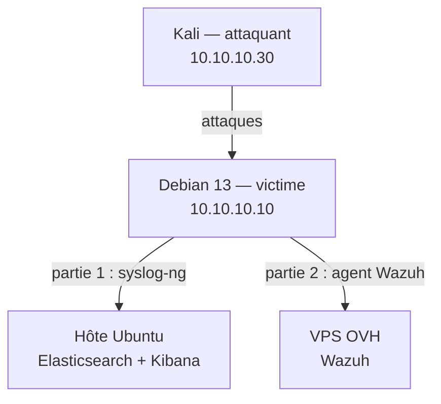
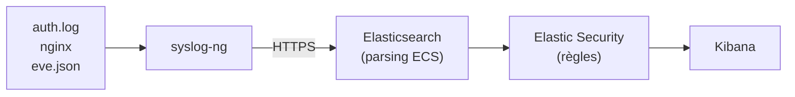
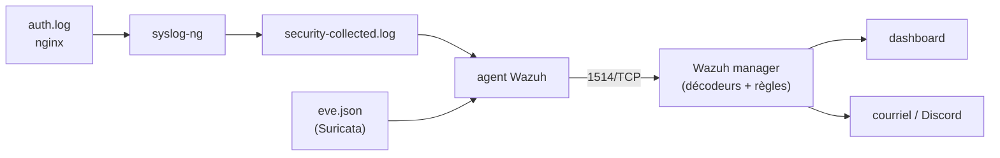

# Système de détection d'anomalies et de gestion de logs

Projet de sécurité des réseaux. Dans un laboratoire virtualisé, une machine attaquante (Kali) cible une machine « victime » (Debian 13). Les logs de sécurité de la victime sont collectés, analysés et visualisés pour détecter cinq scénarios d'intrusion.

> **Ce dépôt documente et outille le lab, il ne le fournit pas clé en main.** Il contient la
> documentation, les configurations et le script de lancement (`lab/lab.sh`). Les éléments lourds
> ou sensibles ne sont pas versionnés : disques des VM (`*.qcow2`), sauvegardes des volumes
> Elasticsearch/Kibana (`*.tgz`), secrets (`.env`, certificats). Deux façons de monter le lab :
>
> - **Restauration rapide**, télécharger le bundle des VM et volumes, le placer à la racine du
>   dépôt, puis `./lab/lab.sh up`. Bundle (VM + volumes) : [lien de télégarchement (onedrive UQAC)](https://uqacca0-my.sharepoint.com/:u:/g/personal/mmarthy_etu_uqac_ca/IQBLox2eeaHCR5zKeKxiRO_6AeFrZEApTsxpMBcexRM6mBo?e=acb5xD).
> - **Reconstruction complète**, suivre les guides [partie 1](docs/1-elk/01-installation.md) et
>   [partie 2](docs/2-wazuh/01-deploiement.md), sans aucun bundle.
>
> Le serveur Wazuh (partie 2) tourne sur une infrastructure externe : un lecteur doit le remplacer
> par sa propre instance Wazuh.

---

## Notre démarche en deux temps

**Partie 1, ELK : on l'a fait, et ça marche.**
On a monté la chaîne demandée par le sujet : syslog-ng → Elasticsearch → Kibana, avec Suricata comme IDS réseau et le moteur de détection d'Elastic Security. Les logs arrivent au format standard ECS, et le brute-force SSH est détecté dans Kibana.

**Partie 2, Wazuh : on a basculé, parce que c'est beaucoup plus simple.**
Pour obtenir ce résultat avec ELK, il a fallu compléter chaque log à la main, réécrire des règles pensées pour un autre collecteur, et contourner la licence pour envoyer une simple notification. Wazuh fait tout cela nativement : décodage des logs, règles de détection, intégrité des fichiers, conformité, alertes par courriel et Discord. Les cinq scénarios sont donc menés sous Wazuh. syslog-ng et Suricata restent en place et alimentent les deux plateformes.

| Ce qu'il a fallu pour… | ELK + Elastic Security | Wazuh |
| --- | --- | --- |
| Comprendre les logs | Installer les intégrations, puis ajouter à la main `input.type`, le fuseau horaire et les champs `host.*` | Décodeurs intégrés, rien à ajouter |
| Détecter un brute-force SSH | Écrire une règle custom : les règles Elastic supposent un agent Elastic | Règle native déclenchée sans réglage (5763) |
| Surveiller l'intégrité des fichiers | auditd + intégration, ou Elastic Defend (agent dédié + Fleet Server) | Module natif (syscheck) |
| Être notifié d'une intrusion | Connecteurs payants (licence) ou script maison | Courriel et Discord, gratuits |

Le comparatif complet, les limites et les perspectives sont dans le [bilan](docs/4-bilan-elk-vs-wazuh.md).

---

## Architecture

### Les machines



| Machine | Rôle | Adresse |
| --- | --- | --- |
| Kali Linux | Attaquant | `10.10.10.30` (réseau `lab-net`, isolé) |
| Debian 13 « victime » | Cible : SSH, nginx + DVWA, MariaDB. Capteurs : Suricata, syslog-ng, agent Wazuh | `10.10.10.10` (lab), `192.168.122.206` (NAT) |
| Hôte Ubuntu 24.04 | Hyperviseur KVM + Elasticsearch et Kibana (Docker) | `192.168.122.1` |
| VPS OVH | Wazuh manager, indexer et dashboard | `sec.grdr.fr` (agents), `wazuh.grdr.fr` (dashboard) |

### Partie 1 : chaîne ELK



### Partie 2 : chaîne Wazuh



---

## Scénarios d'intrusion

| # | Scénario | Attaque (Kali) | Détection Wazuh | Détection ELK | MITRE | État |
| --- | --- | --- | --- | --- | --- | --- |
| 1 | Brute-force SSH | `hydra` | Règles 5763 + 2502 | Règle « Lab - Brute-force SSH » | T1110.001 | ✅ Validé (Wazuh et ELK) |
| 2 | Attaque web (SQLi, LFI) | `sqlmap`, `nikto`, `curl` sur DVWA | Règles web + alertes Suricata | Règle « Lab - Attaque web » | T1190 | ✅ Validé |
| 3 | Scan de ports | `nmap -sS` | Alerte Suricata (signature custom) | Règle « Lab - Scan de ports » | T1046 | ✅ Validé |
| 4 | Modification de fichiers sensibles | modification de `/etc/passwd`, dépôt d'un webshell | Intégrité des fichiers (syscheck) | — | T1136.001 / T1505.003 | ✅ Validé (Wazuh) |
| 5 | Malware / élévation de privilèges | fichier EICAR, ajout d'un utilisateur sudo | VirusTotal + règles de gestion des comptes | — | T1105 / T1136.001 | ✅ Validé (Wazuh) |

Description complète, justification et résultats : [docs/3-attaques/00-scenarios.md](docs/3-attaques/00-scenarios.md).

---

## Documentation

**Démarrage rapide** : [lancer le lab](docs/0-lancer-le-lab.md) sur n'importe quel PC Linux (`lab/lab.sh up`).

**Partie 1, ELK**
1. [Installation d'Elasticsearch et Kibana](docs/1-elk/01-installation.md)
2. [Collecte des logs avec syslog-ng](docs/1-elk/02-collecte-syslog-ng.md)
3. [Détection avec Elastic Security](docs/1-elk/03-detection.md)

**Partie 2, Wazuh**
1. [Déploiement et intégration de Wazuh](docs/2-wazuh/01-deploiement.md)

**Partie 3, Attaques**
- Vue d'ensemble : [les cinq scénarios d'intrusion](docs/3-attaques/00-scenarios.md)
- [Attaque 1, Brute-force SSH](docs/3-attaques/01-brute-force-ssh.md)
- [Attaque 2, Attaque web (SQLi, LFI)](docs/3-attaques/02-attaque-web.md)
- [Attaque 3, Scan de ports](docs/3-attaques/03-scan-de-ports.md)
- [Attaque 4, Modification de fichiers sensibles](docs/3-attaques/04-modification-fichiers.md)
- [Attaque 5, Malware et élévation de privilèges](docs/3-attaques/05-malware-privileges.md)

**Synthèse**
- [Bilan ELK vs Wazuh, limites et perspectives](docs/4-bilan-elk-vs-wazuh.md)
- [Pièges rencontrés et solutions](docs/5-pieges-rencontres.md)

## Structure du dépôt

```
.
├── README.md
├── .gitignore                  ← exclut secrets et binaires (images, volumes)
├── docs/
│   ├── 0-lancer-le-lab.md     ← relancer le lab (script lab/lab.sh)
│   ├── 1-elk/                  ← partie 1 : installation, collecte, détection
│   ├── 2-wazuh/                ← partie 2 : déploiement de Wazuh
│   ├── 3-attaques/             ← partie 3 : scénarios + 5 fiches d'attaque + captures
│   ├── 4-bilan-elk-vs-wazuh.md
│   ├── 5-pieges-rencontres.md
│   └── img/                    ← captures Kibana et Wazuh
├── lab/                        ← lab.sh + libvirt/ : lancement des VM et réseaux
├── elk/                        ← Compose Elasticsearch + Kibana (config de référence)
├── syslog-ng/                  ← configuration syslog-ng de la victime
└── elastic-rules/              ← règles de détection Elastic Security (script API)
```

> Les fichiers lourds ou sensibles (images `*.qcow2`, volumes `*.tgz`, `.env`, certificats)
> sont dans le dossier mais ignorés par git (`.gitignore`) : ils ne sont pas poussés et se
> transmettent à part. Voir [lancer le lab](docs/0-lancer-le-lab.md#ce-quil-faut-avoir).

## Versions

| Composant | Version |
| --- | --- |
| Wazuh | 4.14.8 |
| Elasticsearch / Kibana | 9.5.5 (licence Basic) |
| Suricata | 7.0.10 (53 143 règles ET Open) |
| syslog-ng | 4.8.1 |
| Debian (victime) | 13 « Trixie » |
