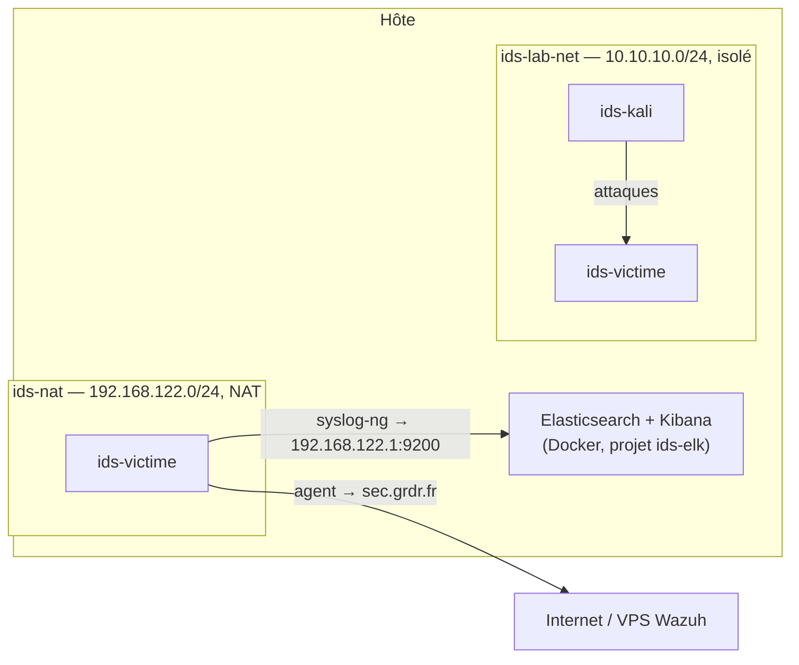

# Lancer le lab

Cette page sert à relancer le lab déjà construit sur n'importe quel PC Linux, à partir des images des VM et des sauvegardes Elasticsearch. La construction pas à pas est décrite dans les parties [1 (ELK)](1-elk/01-installation.md) et [2 (Wazuh)](2-wazuh/01-deploiement.md).

Un seul script s'occupe de tout : `lab/lab.sh`. Il ne dépend pas de la distribution et ne demande pas `sudo`.

## Ce qu'il faut avoir

Le dossier du projet, tel qu'il circule entre nous :

```
projet-ids/                  ← LE DÉPÔT GIT (et dossier de travail du lab)
├── docs/                    ← cette documentation
├── lab/                     ← lab.sh + libvirt/ (définition des VM et des réseaux)
├── elk/
│   ├── compose.yaml  .env.example  README.md   ← versionnés (partent sur git)
│   ├── .env  certs/  ca.crt                     ← secrets, ignorés par git
│   ├── elk-secrets.tgz                          ← .env + certificats, ignoré
│   └── esdata01.tgz  kibanadata.tgz             ← sauvegardes des volumes, ignorées
├── syslog-ng/   elastic-rules/
├── debian13.qcow2  kali.qcow2                   ← disques des VM, ignorés
└── README.md   .gitignore
```

Tout vit dans `projet-ids/`. Les fichiers versionnés (doc, `compose.yaml`, scripts…) partent
sur git ; les gros fichiers et les secrets (`*.qcow2`, `.env`, `certs/`, `*.tgz`) sont dans le
**même dossier mais ignorés par git** (voir `.gitignore`), ils ne sont pas poussés et se
transmettent à part. `lab.sh` les trouve sans configuration. (Pour les ranger ailleurs, pointer
`IDS_HOME` dessus via `lab/lab.conf` ; voir `lab/lab.conf.example`.)

## Prérequis de l'hôte

| Besoin | Pourquoi |
| --- | --- |
| Linux x86_64, virtualisation activée dans le BIOS (VT-x / AMD-V) | VM accélérées par KVM |
| **16 Go de RAM** conseillés | Victime 4 Go + Kali 2 Go + Elasticsearch 4 Go + Kibana 2 Go |
| ~25 Go d'espace libre dans `/var/lib/libvirt/images` | Images importées + écritures des VM |
| libvirt + QEMU/KVM | Les VM |
| Docker Engine + plugin Compose v2 | Elasticsearch et Kibana |
| `vm.max_map_count ≥ 262144` | Exigé par Elasticsearch |

Installation des paquets :

| Distribution | Commande |
| --- | --- |
| Debian / Ubuntu | `sudo apt install qemu-system-x86 libvirt-daemon-system virt-manager` |
| Fedora | `sudo dnf install @virtualization` |
| Arch / Manjaro / CachyOS | `sudo pacman -S qemu-desktop libvirt dnsmasq virt-manager` |

Docker : suivre [la procédure officielle](https://docs.docker.com/engine/install/) de sa distribution (le paquet `docker.io` de Debian/Ubuntu convient aussi, avec `docker-compose-v2`).

Puis, une seule fois :

```bash
sudo systemctl enable --now libvirtd docker
sudo usermod -aG libvirt,docker $USER        # puis se déconnecter / reconnecter
echo 'vm.max_map_count=262144' | sudo tee /etc/sysctl.d/99-elastic.conf && sudo sysctl --system
```

Les groupes `libvirt` et `docker` permettent de lancer le script sans `sudo`. Le script vérifie tous ces points au démarrage et indique la commande à lancer s'il en manque un.

## Utilisation

Depuis le dossier `lab/` :

```bash
./lab.sh up        # tout démarrer
./lab.sh status    # état des réseaux, VM et conteneurs
./lab.sh down      # tout arrêter (les données sont conservées)
./lab.sh reset     # remettre les VM dans l'état d'origine (VM arrêtées)
./lab.sh destroy   # tout supprimer, sauf les volumes Docker
```

Le premier `up` est plus long : il importe les deux images (≈ 10 Go), restaure les volumes Docker et télécharge les images Elasticsearch et Kibana. Les suivants démarrent en une minute environ, plus 2 à 3 minutes pour qu'Elasticsearch soit prêt.

| Accès | Adresse |
| --- | --- |
| Kibana | `http://localhost:5601`, compte `elastic`, mot de passe `ELASTIC_PASSWORD` dans `elk/.env` |
| Victime | `192.168.122.206` depuis l'hôte, `10.10.10.10` depuis Kali |
| Kali | `10.10.10.30`, uniquement sur le réseau du lab |
| Écrans des VM | `virt-manager` (connexion « QEMU/KVM »), ou `virt-viewer -c qemu:///system ids-kali` |
| Wazuh | `https://wazuh.grdr.fr` (sur le VPS, indépendant du script) |

## Ce que fait le script



- **Tout est préfixé `ids-`** (VM, réseaux, pool de disques, projet Docker) : le lab ne touche à aucune autre VM ni conteneur de l'hôte.
- **Deux réseaux dédiés.** `ids-nat` donne Internet à la victime (agent Wazuh) et lui permet de joindre Elasticsearch. `ids-lab-net` n'a aucune sortie : Kali ne peut atteindre que la victime. Les adresses sont fixées par réservation DHCP sur les adresses MAC.
- **Images de base intactes.** Les images sont importées dans le pool `ids-lab` (`/var/lib/libvirt/images/ids-lab`), puis chaque VM écrit dans un overlay qcow2 posé dessus. `reset` supprime simplement les overlays : on retrouve exactement l'état livré, ce qui permet de rejouer un scénario sur une victime propre.
- **Volumes Docker restaurés une seule fois.** Si `ids-elk_esdata01` existe déjà, il n'est pas écrasé. Pour repartir de la sauvegarde : `./lab.sh destroy`, puis `docker volume rm ids-elk_esdata01 ids-elk_kibanadata`, puis `./lab.sh up`.
- **Vérifications.** Avant de démarrer, le script contrôle les prérequis de l'hôte. Après, il attend que la victime obtienne son adresse, et signale un pare-feu bloquant si elle ne vient pas.

### Pourquoi les adresses sont imposées

L'hôte doit être joignable en `192.168.122.1` : c'est l'adresse inscrite dans le certificat d'Elasticsearch et celle que vise syslog-ng sur la victime. Le réseau `ids-nat` reprend donc ce sous-réseau. Or le réseau `default` de libvirt l'utilise souvent aussi : s'il est actif, le script propose de le désactiver le temps du lab (`virsh net-start default` pour le relancer).

### Différences avec les VM d'origine

Les fichiers `debian13.xml` et `kali.xml` à la racine sont les exports bruts du PC d'origine (Ubuntu). Ils ne sont plus utilisés : `lab/libvirt/` en contient une version portable.

| Changement | Raison |
| --- | --- |
| Machine `q35` au lieu de `pc-q35-noble` | `pc-q35-noble` n'existe que dans le QEMU d'Ubuntu : `virsh define` échouait ailleurs |
| Pas de chemin d'émulateur | Il varie selon la distribution (`/usr/libexec/qemu-kvm` sur Fedora/RHEL) ; libvirt choisit le bon |
| Affichage VNC au lieu de SPICE, sans son ni redirection USB | SPICE n'est pas disponible partout ; le reste est inutile au lab |
| RAM : victime 8 → 4 Go, Kali 4 → 2 Go | Tenir sur un PC de 16 Go avec Elasticsearch et Kibana |
| Kali sans carte NAT | Kali ne doit pas pouvoir joindre Elasticsearch (voir [pièges](5-pieges-rencontres.md)) |
| Réseaux `ids-nat` et `ids-lab-net` | Ne pas modifier le réseau `default` de l'hôte |

Les adresses MAC et les emplacements PCI des cartes sont conservés : les interfaces gardent leurs noms dans les VM (`enp1s0` pour le NAT, `enp7s0` pour le lab), dont dépendent NetworkManager et Suricata.

## Jusqu'où va le script

Le script ne rejoue aucun guide : il restaure un lab déjà construit. Tout ce que les guides font installer se trouve déjà soit dans les sauvegardes ELK, soit dans le disque de la victime.

| Guide | Contenu | Où il se trouve | État |
| --- | --- | --- | --- |
| [1.1](1-elk/01-installation.md) | `.env`, CA et certificat d'Elasticsearch | `elk-secrets.tgz` | ✅ restauré |
| [1.1](1-elk/01-installation.md) | Template `logs@custom`, intégrations System, Nginx, Suricata, Auditd | volume `esdata01` | ✅ restauré |
| [1.2](1-elk/02-collecte-syslog-ng.md) | Rôle `syslog_writer` et compte `syslog-ng` | volume `esdata01` | ✅ restauré |
| [1.2](1-elk/02-collecte-syslog-ng.md) | syslog-ng sur la victime (`elastic.conf`, `security.conf`, CA) | disque de la victime | ✅ inclus |
| [1.3](1-elk/03-detection.md) | Règles Elastic activées et quatre règles `lab-*` | volume `esdata01` | ✅ restauré |
| [1.3](1-elk/03-detection.md) | Signature Suricata de scan `sid:1000001` | disque de la victime | ✅ inclus |
| — | Logs collectés jusqu'au 15/10/2026 | volume `esdata01` | ✅ restauré |
| [2.1](2-wazuh/01-deploiement.md) | Serveur Wazuh | VPS OVH | hors script, déjà en ligne |
| [2.1](2-wazuh/01-deploiement.md) | Agent Wazuh enrôlé, lecture de `security-collected.log` et `eve.json` | disque de la victime | ✅ inclus |
| [2.1](2-wazuh/01-deploiement.md) | FIM temps réel (`/etc/passwd`, `/var/www/dvwa`…) | disque de la victime | ✅ inclus |
| [2.1](2-wazuh/01-deploiement.md) | Notifications Discord / courriel, VirusTotal | manager Wazuh (VPS) | ⬜ à configurer (scénario 5) |
| [2.2](3-attaques/00-scenarios.md) | Les attaques des cinq scénarios | — | à lancer à la main depuis Kali |

Les cibles des attaques (nginx, DVWA, MariaDB, SSH) et Suricata, qui écoute sur `enp7s0`, sont dans le disque de la victime.

Toute modification faite dans une VM est conservée par `down` / `up`, mais effacée par `reset`. Pour qu'elle devienne permanente et soit partagée avec tout le monde, il faut l'intégrer à l'image (ci-dessous).

### Modifier l'image de la victime

Modifications déjà intégrées à `debian13.qcow2` le 21/10/2026 :

| Modification | Fichier dans la victime |
| --- | --- |
| syslog-ng activé au démarrage | `systemctl enable syslog-ng` |
| Signature de scan `sid:1000001` (scénario 3) | `/etc/suricata/rules/local.rules`, déclarée dans `rule-files` de `/etc/suricata/suricata.yaml` |
| FIM temps réel sur `/etc/passwd`, `/etc/shadow`, `/etc/sudoers`, `/var/www/dvwa` (scénarios 4 et 5) | bloc `<syscheck>` de `/var/ossec/etc/ossec.conf` |
| Suppression du verrou orphelin de Wazuh au démarrage | `/etc/systemd/system/wazuh-agent.service.d/lab-verrou.conf` |

Procédure pour en ajouter une, depuis la racine du dépôt (`projet-ids/`, où se trouvent les `*.qcow2`) :

1. **Partir d'un overlay neuf**, pour ne pas figer dans l'image les traces des tests : `./lab/lab.sh down`, puis `./lab/lab.sh reset`, puis `./lab/lab.sh up`.
2. **Faire uniquement la modification** dans la victime, et la valider (`suricata -T`, `systemctl status`…).
3. **Arrêter les services avant d'éteindre la VM** : `systemctl stop wazuh-agent suricata syslog-ng`, puis `poweroff`. Un arrêt pendant le démarrage de Wazuh laisse un verrou dans l'image (voir [pièges](5-pieges-rencontres.md)).
4. **Fusionner l'overlay dans l'image du projet** :

```bash
cp --reflink=auto debian13.qcow2 debian13.qcow2.bak          # sauvegarde
virsh -c qemu:///system vol-download --pool ids-lab victime.qcow2 /tmp/overlay.qcow2
qemu-img rebase -u -F qcow2 -b "$PWD/debian13.qcow2" /tmp/overlay.qcow2
qemu-img commit /tmp/overlay.qcow2 && rm /tmp/overlay.qcow2
```

5. **Réimporter l'image** : `virsh -c qemu:///system vol-delete --pool ids-lab victime.qcow2`, puis la même commande pour `debian13.qcow2`, puis `./lab/lab.sh up`.
6. **Redistribuer `debian13.qcow2`** et noter la modification dans le tableau ci-dessus.

### Restaurer n'est pas réinstaller

Les étapes ✅ ci-dessus ne doivent pas être rejouées. Surtout, il ne faut pas régénérer le `.env` : les mots de passe sont enregistrés dans les données, et la victime connaît déjà la CA et le mot de passe `syslog-ng`.

Correspondances avec les guides :

| Dans les guides | Dans le dossier livré |
| --- | --- |
| `elk/compose.yaml`, `elk/.env.example` (versionnés) | `elk/.env` rempli à partir de `.env.example` (présent dans `elk/`, mais ignoré par git) |
| bridge `virbr0` (réseau `default`) | bridge `virbr-ids` (réseau `ids-nat`), même adresse `192.168.122.1` |
| `bash elastic-rules/create-rules.sh` | `ENV_FILE=../elk/.env bash elastic-rules/create-rules.sh` depuis `projet-ids/`, inutile sauf pour recréer une règle supprimée |

Les commandes de vérification des guides (`curl … $ES`, comptage des documents, `_simulate`) restent valables, en se plaçant dans `elk/` à la racine du projet. Après un premier lancement, `elk/certs/` appartient à root : utiliser `elk/ca.crt` pour `--cacert`.

## En cas de problème

| Symptôme | Solution |
| --- | --- |
| `Erreur : …` au lancement | Le script indique la commande à lancer |
| « aucun bail DHCP sur ids-nat » : les VM n'ont pas d'IP | Le pare-feu de l'hôte bloque DHCP/DNS sur les bridges. Avec ufw (actif par défaut sur CachyOS, souvent sur Ubuntu), voir ci-dessous. firewalld (Fedora) n'est pas concerné : libvirt y déclare ses bridges tout seul |
| La victime a une IP mais pas Internet (agent Wazuh déconnecté) | Transit (`FORWARD`) bloqué par ufw ou Docker. Avec ufw : `sudo ufw route allow in on virbr-ids`. Sans ufw, avec Docker : `sudo iptables -I DOCKER-USER -i virbr-ids -j ACCEPT` et `sudo iptables -I DOCKER-USER -o virbr-ids -m conntrack --ctstate RELATED,ESTABLISHED -j ACCEPT` |
| `ids-elk-es01-1` redémarre en boucle | `docker logs ids-elk-es01-1` ; souvent la RAM : baisser `ES_MEM_LIMIT` dans `elk/.env` |
| Elasticsearch refuse de démarrer : `bind … 192.168.122.1` | Le réseau `ids-nat` n'était pas actif : relancer `./lab.sh up` |
| Une VM démarre sans réseau | Dans la VM : `nmcli device connect enp1s0` (ou `enp7s0`) |

Les autres problèmes déjà rencontrés sont dans [pièges rencontrés](5-pieges-rencontres.md).
