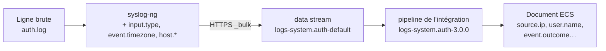
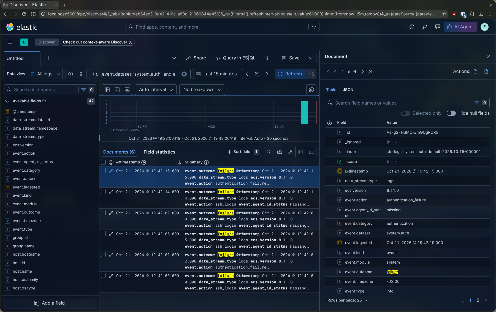

# Partie 1.2 — Collecte des logs avec syslog-ng

> **Partie 1 — ELK.** Cette partie déploie la chaîne exigée par le sujet (syslog-ng → Elasticsearch → Kibana) et la rend fonctionnelle de bout en bout. Les scénarios d'intrusion sont ensuite menés sous Wazuh ([partie 2](../2-wazuh/01-deploiement.md)) ; le [bilan](../4-bilan-elk-vs-wazuh.md) explique ce choix.


syslog-ng est le collecteur imposé par le sujet. Sur la victime, il lit les fichiers de logs de sécurité et les envoie à Elasticsearch. La configuration est dans [`syslog-ng/elastic.conf`](../../syslog-ng/elastic.conf).

## Logs collectés et justification

On ne collecte pas « tout » : chaque source répond à un ou plusieurs scénarios d'intrusion.

| Fichier | Contenu | Pourquoi ce log est prioritaire | Scénarios |
| --- | --- | --- | --- |
| `/var/log/auth.log` | Authentifications SSH, sudo, PAM, création de comptes | Trace directe des accès et des tentatives d'accès au système | 1, 5 |
| `/var/log/nginx/access.log` | Chaque requête HTTP reçue (URL, IP, user-agent, code retour) | Les injections SQL, LFI et scanners web apparaissent dans les URL et les user-agents | 2 |
| `/var/log/nginx/error.log` | Erreurs du serveur web | Révèle les requêtes malformées et les erreurs PHP provoquées par une exploitation | 2 |
| `/var/log/suricata/eve.json` | Alertes, flux réseau, requêtes HTTP/DNS vus par Suricata | Seule source qui voit le réseau : scans, signatures d'attaque connues | 2, 3 |

Les événements `stats` de Suricata (des compteurs internes, un toutes les 8 secondes) sont filtrés : ils n'ont aucune valeur pour la sécurité et représentaient la majorité du volume.

## Principe : syslog-ng transporte, Elastic parse



syslog-ng n'analyse pas le contenu des logs (`flags(no-parse)`). Il envoie chaque ligne intacte dans le data stream de l'intégration Elastic correspondante. Le pipeline d'ingestion de l'intégration la découpe ensuite en champs **ECS** (Elastic Common Schema).

Pourquoi ce choix plutôt qu'un parsing dans syslog-ng :

- **Les règles de détection d'Elastic Security** s'appuient sur les champs ECS (`source.ip`, `event.outcome`, etc.). Un format maison les rendrait inutilisables.
- **Les pipelines Elastic** sont maintenus par l'éditeur et couvrent des centaines de formats de messages.
- **syslog-ng garde son rôle de collecteur**, conformément au sujet.

## Champs ajoutés par syslog-ng

Un agent Elastic ajouterait ces champs automatiquement. syslog-ng doit les fournir lui-même :

| Champ | Valeur | Pourquoi |
| --- | --- | --- |
| `@timestamp` | heure de réception | Champ obligatoire d'un data stream |
| `message` | la ligne brute | Le pipeline de l'intégration la parse |
| `input.type` | `log` | **Obligatoire** : le pipeline System n'aiguille le parsing que si ce champ vaut `log` ou `journald` |
| `event.timezone` | décalage local (`${TZOFFSET}`) | Les lignes syslog ne portent pas de fuseau ; sans lui, les heures sont interprétées en UTC |
| `host.name` | nom de la machine | Vues « Hosts » d'Elastic Security |
| `host.id` | nom de la machine | Clé de corrélation des règles EQL d'Elastic |
| `host.os.type` / `host.os.family` | `linux` / `debian` | Filtré par les règles ES\|QL d'Elastic (sinon erreur `Unknown column`) |

## Compte dédié dans Elasticsearch

syslog-ng ne se connecte pas avec le super-utilisateur `elastic`, mais avec un compte qui ne peut **qu'écrire** dans les data streams `logs-*`. Il ne peut rien lire, rien supprimer, et n'a accès à aucun autre index (principe du moindre privilège).

Sur l'hôte, depuis `elk/` (avec `ES` et `AUTH` définis comme dans [docs/01](01-installation.md)) :

```bash
curl -s --cacert ca.crt -u $AUTH -X PUT "$ES/_security/role/syslog_writer" \
  -H 'Content-Type: application/json' \
  -d '{"indices":[{"names":["logs-*-*"],"privileges":["create_doc","auto_configure"]}]}'

curl -s --cacert ca.crt -u $AUTH -X PUT "$ES/_security/user/syslog-ng" \
  -H 'Content-Type: application/json' \
  -d '{"password":"<mot_de_passe_syslog-ng>","roles":["syslog_writer"]}'
```

Ce mot de passe est ensuite reporté dans `elastic.conf`.

## Installation sur la victime

En root (`su - root`) :

```bash
# Module HTTP de syslog-ng (non installé par défaut sur Debian)
apt install -y syslog-ng-mod-http

# CA d'Elasticsearch, pour vérifier son certificat
install -m 644 /tmp/ca.crt /etc/syslog-ng/elastic-ca.crt

# Configuration
cp elastic.conf /etc/syslog-ng/conf.d/
syslog-ng --syntax-only && systemctl restart syslog-ng
systemctl status syslog-ng --no-pager | head -5
```

`elastic.conf` **s'ajoute** à la configuration existante (`security.conf`) sans la modifier. Le fichier `security-collected.log`, lu par l'agent Wazuh, continue d'être alimenté : les deux chaînes de collecte fonctionnent en parallèle.

## Lecture de la configuration

**Sources.** Chaque fichier est lu avec un `persist-name` distinct. Ces fichiers sont déjà lus par `security.conf`, et syslog-ng refuse deux sources identiques sans nom de persistance différent.

```
source s_es_auth { file("/var/log/auth.log" flags(no-parse) persist-name("es_auth")); };
```

**Aiguillage.** Une réécriture attribue à chaque source son data stream cible :

```
rewrite r_es_auth { set("logs-system.auth-default" value("es_index")); };
```

**Destination.** Une seule destination HTTP vers l'API `_bulk` d'Elasticsearch :

- envoi par lots de 200 lignes, ou toutes les 2 secondes ;
- TLS avec vérification du certificat (`peer-verify(yes)`) ;
- action `create`, obligatoire pour écrire dans un data stream.

```
body("{\"create\":{\"_index\":\"${es_index}\"}}\n$(format-json @timestamp=${ISODATE} message=${MESSAGE} input.type=log ...)")
```

**Filtre Suricata.** Il écarte les événements `stats` :

```
filter f_es_no_stats { not message('"event_type":"stats"' type(string) flags(substring)); };
```

## Vérification

Générer un peu d'activité depuis Kali :

```bash
ssh faux@10.10.10.10                                  # 2-3 mauvais mots de passe
curl -s "http://10.10.10.10/?id=1'%20OR%20'1'='1" > /dev/null
```

Puis, sur l'hôte, compter les documents reçus :

```bash
curl -s --cacert ca.crt -u $AUTH "$ES/_cat/indices/.ds-logs-*?v&h=index,docs.count,health"
```

```
index                                           docs.count health
.ds-logs-system.auth-default-2026.10.15-000001         424 green
.ds-logs-suricata.eve-default-2026.10.15-000001       5711 green
.ds-logs-nginx.error-default-2026.10.15-000001           5 green
.ds-logs-nginx.access-default-2026.10.15-000001         32 green
```

Au premier démarrage, syslog-ng relit l'historique des fichiers, d'où les volumes importants.

### Contrôle de la qualité du parsing

L'API `_bulk` répond « OK » même si un document individuel est rejeté. Il faut donc contrôler le parsing séparément :

```bash
for ds in system.auth nginx.access nginx.error suricata.eve; do
  tot=$(curl -s --cacert ca.crt -u $AUTH "$ES/logs-$ds-default/_count" | grep -o '"count":[0-9]*' | cut -d: -f2)
  err=$(curl -s --cacert ca.crt -u $AUTH "$ES/logs-$ds-default/_count?q=_exists_:error.message" | grep -o '"count":[0-9]*' | cut -d: -f2)
  echo "$ds total=$tot erreurs=$err"
done
```

Résultat obtenu : **0 erreur de parsing sur les quatre sources**.

### Dans Kibana

Dans **Discover**, avec la vue de données « Tous les logs » :

```
event.dataset:"system.auth" and event.outcome:"failure" and source.ip:"10.10.10.30"
```

Filtrer sur `event.dataset` et non sur `data_stream.dataset` : ce second champ n'est pas renseigné dans nos documents (voir [pièges](../5-pieges-rencontres.md)).



Un document `system.auth` déplié : la ligne brute d'`auth.log` est devenue des champs **ECS** (`source.ip`, `user.name`, `process.name`, `event.outcome`), exploitables par les règles de détection.
