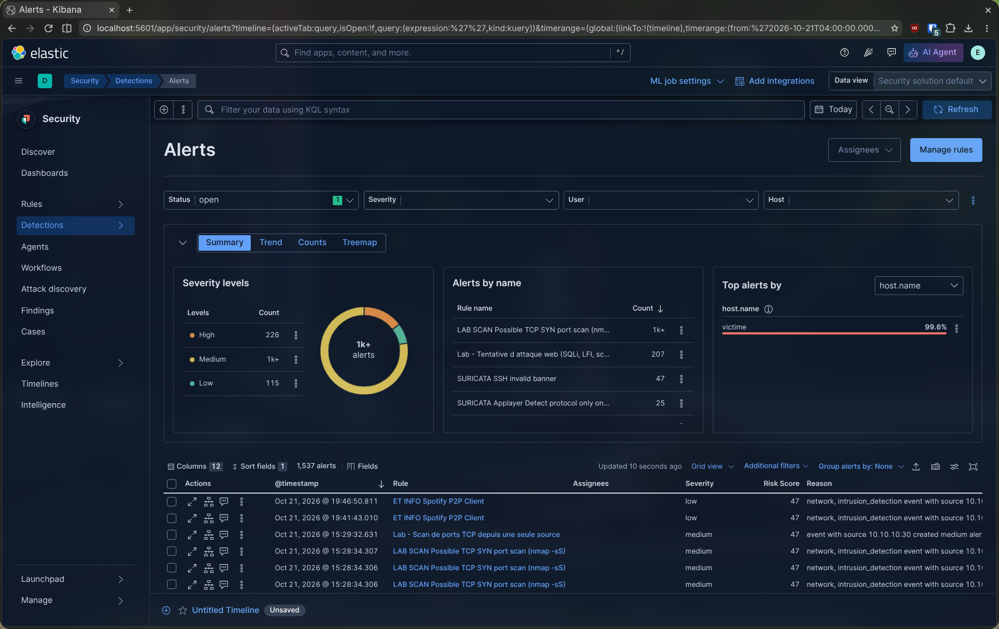
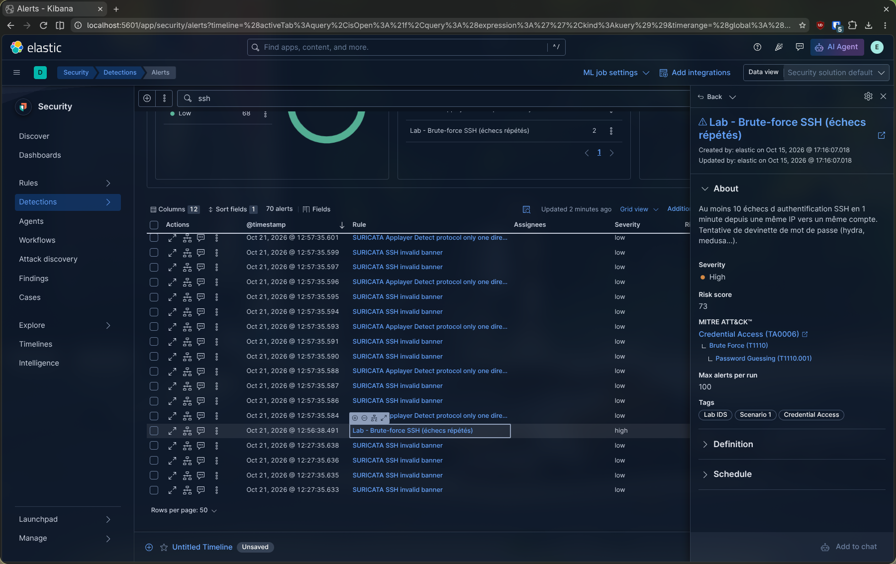
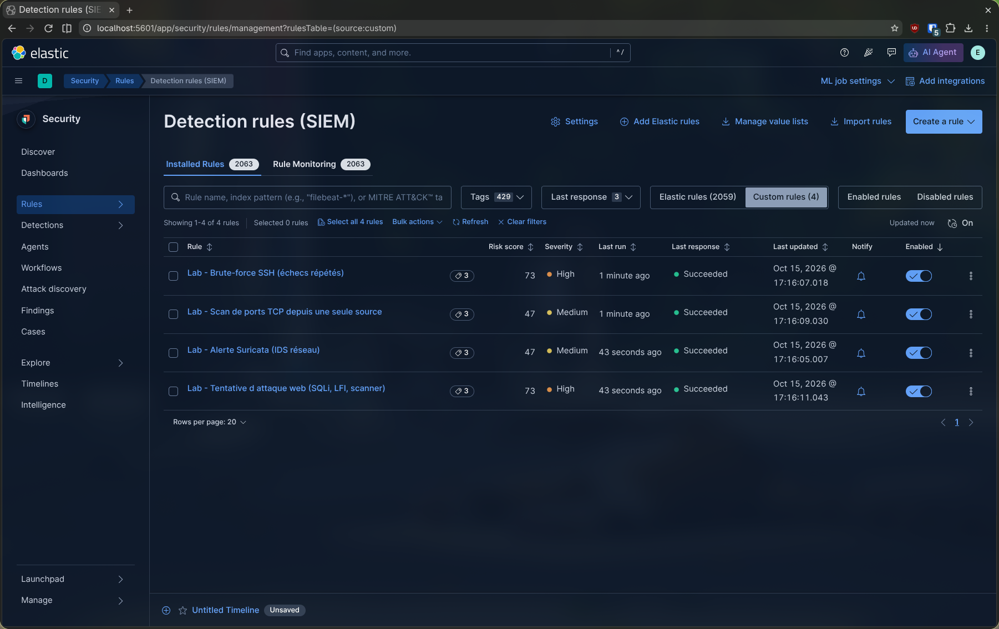

# Partie 1.3 — Détection avec Elastic Security

> **Partie 1 — ELK.** Cette partie déploie la chaîne exigée par le sujet (syslog-ng → Elasticsearch → Kibana) et la rend fonctionnelle de bout en bout. Les scénarios d'intrusion sont ensuite menés sous Wazuh ([partie 2](../2-wazuh/01-deploiement.md)) ; le [bilan](../4-bilan-elk-vs-wazuh.md) explique ce choix.


## Qui détecte quoi

Elasticsearch stocke et Kibana affiche, mais aucun des deux ne détecte quoi que ce soit par lui-même. La détection vient de trois sources :

| Source | Type | Ce qu'elle voit |
| --- | --- | --- |
| **Suricata** | IDS réseau à signatures (53 143 règles ET Open + règle custom) | Le trafic réseau : signatures d'attaques connues, scans |
| **Moteur de détection d'Elastic Security** | Règles de corrélation exécutées sur les données stockées | Tous les logs : seuils, séquences, combinaisons de champs |
| **Wazuh** (outil complémentaire) | HIDS | Intégrité des fichiers, conformité CIS, corrélation côté hôte |

Les règles d'Elastic Security tournent à intervalle régulier (toutes les minutes pour nos règles). Chaque correspondance crée une **alerte**, consultable dans Kibana.

## Règles fournies par Elastic

Installation : **Security → Rules → Detection rules → Add Elastic rules → Install all** (2 059 règles).

Toutes les règles sont installées désactivées. On n'active que celles qui portent sur des données réellement collectées. Les autres attendent des sources absentes du lab (Windows, Elastic Defend, cloud) : elles tourneraient pour rien ou échoueraient.

| Règle Elastic | État | Raison |
| --- | --- | --- |
| Potential Internal Linux SSH Brute Force Detected | ✅ Activée | Brute-force SSH depuis une IP privée : le cas de Kali |
| Potential Successful SSH Brute Force Attack | ✅ Activée | Série d'échecs suivie d'une connexion réussie |
| Newly Observed High Severity Suricata Alert | ➕ Recommandée | Première apparition d'une alerte Suricata de haute sévérité |
| Potential External Linux SSH Brute Force Detected | ❌ | Exclut justement les IP privées : ne verrait jamais Kali |
| Endpoint Security (Elastic Defend), Container Workload Protection | ❌ Désactivées | Activées par défaut, mais sans données (Elastic Defend et conteneurs absents) |
| Suricata and Elastic Defend Network Correlation | ❌ | Exige Elastic Defend |

Les règles Elastic sont écrites pour des données collectées par Elastic Agent. Pour qu'elles fonctionnent avec syslog-ng, il a fallu ajouter les champs `host.id` et `host.os.type` aux documents (voir [docs/02](02-collecte-syslog-ng.md)). Elles restent calibrées pour la production : par exemple, 60 échecs en 30 secondes pour le brute-force. D'où des règles propres au lab, ci-dessous.

## Règles custom

Le script [`elastic-rules/create-rules.sh`](../../elastic-rules/create-rules.sh) crée quatre règles par l'API de Kibana. Chaque règle a un identifiant fixe (`rule_id`) : le script peut être relancé sans créer de doublons.

```bash
# Prérequis : avoir ouvert une fois Security → Alerts (initialise l'index des alertes)
bash elastic-rules/create-rules.sh
```

Le mot de passe `elastic` est lu dans `elk/.env`, jamais écrit dans le script.

### Vue d'ensemble

| Règle | `rule_id` | Type | Données | Scénario | MITRE |
| --- | --- | --- | --- | --- | --- |
| Lab - Alerte Suricata (IDS réseau) | `lab-suricata-promotion` | Requête | `logs-suricata.eve-*` | 2, 3 | selon signature |
| Lab - Brute-force SSH (échecs répétés) | `lab-ssh-bruteforce` | Seuil | `logs-system.auth-*` | 1 | T1110.001 |
| Lab - Scan de ports TCP depuis une seule source | `lab-port-scan` | Seuil + cardinalité | `logs-suricata.eve-*` | 3 | T1046 |
| Lab - Tentative d'attaque web (SQLi, LFI, scanner) | `lab-web-attack` | Requête | `logs-nginx.access-*` | 2 | T1190 |

### Promotion des alertes Suricata

Quand Suricata détecte une attaque, il écrit une alerte dans `eve.json`, et syslog-ng la transmet à Elasticsearch. Mais ce n'est encore qu'un document parmi d'autres : la page **Alertes** d'Elastic Security n'affiche que les alertes produites par ses propres règles.

Cette règle « promeut » chaque alerte Suricata en alerte Elastic Security :

- **Requête :** `event.kind:"alert"` sur les données Suricata.
- **Nom de l'alerte :** celui de la signature Suricata (`rule_name_override: rule.name`).
- **Sévérité :** reprise de Suricata (1 → haute, 2 → moyenne, 3 → basse).

La règle générique « External Alerts » d'Elastic remplit normalement ce rôle, mais elle n'apparaît pas dans la version installée. La règle custom la remplace, en version ciblée sur Suricata.

### Brute-force SSH (scénario 1)

```
event.category:"authentication" and event.action:"ssh_login" and event.outcome:"failure"
seuil : ≥ 10 événements par couple (source.ip, user.name), fenêtre de 2 minutes
```

**Justification du seuil.** Un utilisateur légitime qui se trompe de mot de passe échoue 2 ou 3 fois. Dix échecs en une minute sur un même compte depuis une même IP n'ont rien d'humain, c'est un outil automatisé. On regroupe par **IP + compte** pour distinguer une attaque ciblée d'un balayage de comptes.

### Scan de ports (scénario 3)

```
event.dataset:"suricata.eve" and network.transport:"tcp" and destination.ip:"10.10.10.10"
seuil : par source.ip, cardinalité de destination.port > 50, fenêtre de 6 minutes
```

**Pourquoi des flux et non une signature.** Le jeu de règles ET Open ne détecte pas les scans de ports par défaut. Plutôt que de dépendre d'une signature, on exploite les **flux** que Suricata enregistre pour chaque connexion : si une même IP touche plus de 50 ports distincts, c'est un scan. Un client normal n'en contacte que quelques-uns (22, 80, 443).

C'est l'illustration de la corrélation : aucun flux pris isolément n'est suspect, c'est leur agrégation qui l'est.

**Fenêtre de 6 minutes.** Suricata n'écrit un flux qu'à son expiration, environ une minute pour un SYN resté sans réponse. La fenêtre absorbe ce délai.

Une signature Suricata custom complète cette règle (`sid:1000001`, plus de 50 SYN en 5 secondes depuis une même source ; déployée dans `/etc/suricata/rules/local.rules`). Son alerte remonte à la fois dans Elastic, via la règle de promotion, et dans Wazuh.

### Attaque web (scénario 2)

```
event.dataset:"nginx.access" and (
  url.original:(*UNION* or *union* or *%27* or *OR%201=1* or *../* or *etc/passwd*)
  or user_agent.original:(*sqlmap* or *Nikto* or *nikto*) )
```

| Motif | Attaque |
| --- | --- |
| `UNION`, `%27` (apostrophe encodée), `OR 1=1` | Injection SQL |
| `../`, `etc/passwd` | Traversée de répertoire / inclusion de fichier local (LFI) |
| user-agent `sqlmap`, `Nikto` | Outils d'attaque automatisés |

Cette détection est complémentaire de Suricata. Suricata analyse les paquets à la volée ; cette règle relit la requête telle que nginx l'a reçue et décodée.

## Consulter les alertes

| Où | Usage |
| --- | --- |
| **Security → Détections → Alertes** | Vue principale : toutes les alertes, histogramme, filtres par sévérité ou par règle |
| Détail d'une alerte → **Investiguer dans la chronologie** | Tous les événements liés : la vue d'analyse de l'intrusion |
| **Security → Règles** → une règle → **Résultats d'exécution** | Prouve qu'une règle a tourné, même sans alerte |
| Discover sur l'index `.alerts-security.alerts-default` | Requêtes libres sur les alertes ; base du dashboard personnalisé |



Vue principale des alertes, après les cinq scénarios.



Détail d'une alerte « Lab - Brute-force SSH » : l'IP `10.10.10.30` et le compte ciblé.



Les quatre règles `lab-*` s'exécutent sans erreur (état « Succeeded »), preuve qu'elles tournent même sans alerte.

## Notifications : limite de la licence gratuite

Le sujet demande une notification (courriel ou SMS) dès qu'une intrusion est confirmée. Avec la licence **Basic** (gratuite), les actions des règles se limitent à écrire dans un index ou dans le journal de Kibana. Les connecteurs courriel, Slack, Teams et webhook sont réservés aux licences payantes.

Les contournements possibles :

- la **licence d'essai de 30 jours**, qui débloque les connecteurs, mais seulement le temps de l'essai ;
- un **script externe** qui interroge `.alerts-security.alerts-default` et relaie les nouvelles alertes.

Wazuh, lui, envoie les alertes par courriel et vers Slack **nativement et gratuitement**. C'est l'un des arguments de la bascule (voir le [bilan](../4-bilan-elk-vs-wazuh.md)) : les notifications sont traitées dans la [partie 2](../2-wazuh/01-deploiement.md#notifications).

## Pourquoi pas Elastic Defend

Elastic Defend est l'EDR d'Elastic. Il aurait rendu les scénarios 4 et 5 natifs (détection de malware, arbre des processus). Il a été écarté pour quatre raisons :

1. **Il remplace syslog-ng au lieu de s'y ajouter.** Il passe par Elastic Agent, qui collecte lui-même, alors que le sujet impose syslog-ng comme collecteur.
2. **Il exige un Fleet Server** : un service supplémentaire, avec ses certificats, l'enrôlement des agents et des politiques à gérer.
3. **Il doublonne avec Wazuh**, déjà installé sur la victime (FIM, détection d'élévation de privilèges, VirusTotal).
4. **Une partie de ses protections est payante** (comportementale, mémoire, ransomware).

En production, Elastic Agent + Defend remplacerait avantageusement syslog-ng : collecte, EDR et règles Elastic utilisables sans adaptation.

## Ce que la partie 1 démontre

- La chaîne du sujet, **syslog-ng → Elasticsearch → Kibana**, fonctionne de bout en bout, avec TLS et un compte à privilèges minimaux.
- Les logs sont convertis au format **ECS**, avec 0 erreur de parsing sur les quatre sources.
- **Le scénario 1 (brute-force SSH) est détecté** par une règle Elastic Security et visible dans la page Alertes.
- Le coût est élevé : il a fallu compléter chaque document à la main (`input.type`, `event.timezone`, `host.*`), réécrire des règles et contourner la licence pour les notifications. C'est ce constat qui motive la [partie 2](../2-wazuh/01-deploiement.md).
