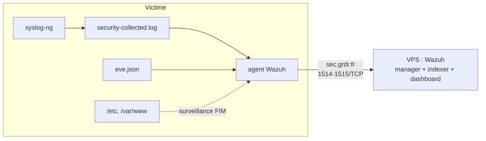
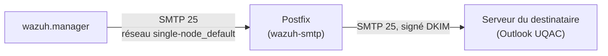
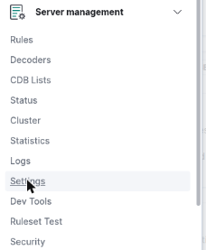
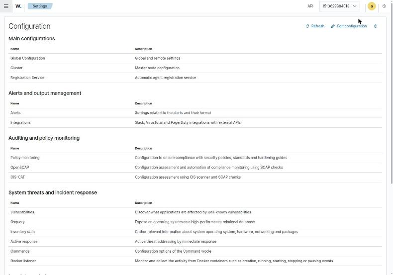
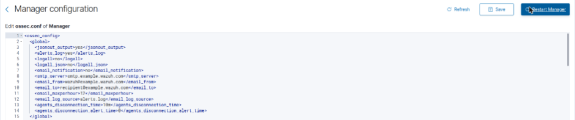
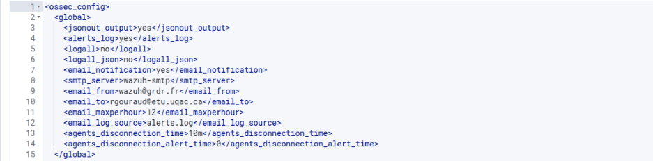
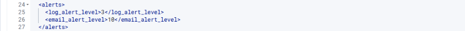
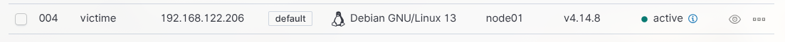
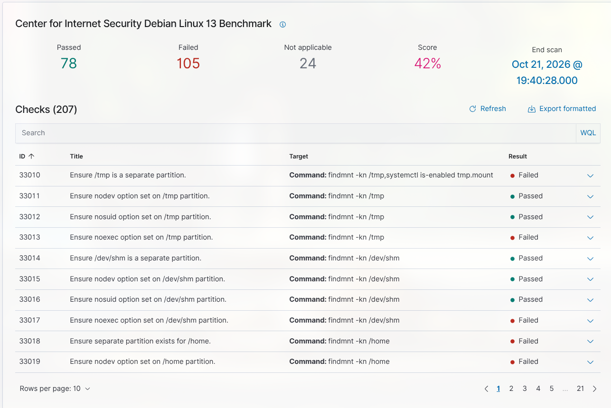

# Partie 2 : Déploiement et intégration de Wazuh

> **Partie 2, Wazuh.** Après avoir monté la chaîne ELK ([partie 1](../1-elk/01-installation.md)), on mène les scénarios d'intrusion sous Wazuh, beaucoup plus direct pour un lab de cette taille. Le [bilan](../4-bilan-elk-vs-wazuh.md) détaille pourquoi.

Wazuh est une plateforme de sécurité open source qui assure plusieurs fonctions :

- **HIDS** : détection d'intrusion côté hôte ;
- **SIEM** : collecte et corrélation des logs ;
- **intégrité des fichiers** (FIM) ;
- **conformité** (CIS) ;
- **réponse active**.

Elle se compose de trois briques côté serveur et d'un agent sur chaque machine surveillée.

| Brique | Rôle |
| --- | --- |
| **Manager** | Reçoit les événements des agents, les décode et applique les règles de détection |
| **Indexer** | Stocke les alertes (fork d'OpenSearch, lui-même dérivé d'Elasticsearch) |
| **Dashboard** | Interface de visualisation (fork d'OpenSearch Dashboards, dérivé de Kibana) |
| **Agent** | Installé sur la victime : lit les logs, surveille les fichiers, envoie tout au manager |

## Architecture retenue



Le serveur Wazuh tourne sur un VPS OVH, déjà utilisé pour d'autres projets. Il est donc séparé du lab, comme le serait un SOC réel.

- **L'agent de la victime** joint le manager par le nom `sec.grdr.fr`, sur les ports 1514 (événements) et 1515 (enrôlement), ouverts sur le pare-feu réseau d'OVH.
- **Le dashboard** est publié sur `wazuh.grdr.fr` par un tunnel Cloudflare, derrière une authentification Cloudflare Access. Il n'est jamais exposé directement sur Internet.

> **Pour reproduire cette partie**, remplacez `sec.grdr.fr` (manager) et `wazuh.grdr.fr` (dashboard)
> par votre propre instance Wazuh : une VM, un VPS, ou même un déploiement local sur l'hôte.
> Seule l'adresse du manager, passée à l'agent via `WAZUH_MANAGER` lors de l'enrôlement, doit
> correspondre à la vôtre ; le reste du guide est identique. Le tunnel Cloudflare n'est qu'un
> confort d'accès au dashboard, pas une nécessité.

## Côté serveur (VPS)

Déploiement single-node en Docker Compose, à partir du dépôt officiel `wazuh-docker`, version 4.14.8.

```bash
git clone https://github.com/wazuh/wazuh-docker.git -b v4.14.8
cd wazuh-docker/single-node
docker compose -f generate-indexer-certs.yml run --rm generator   # certificats internes
docker compose up -d
```

Prérequis système, exigé par l'indexer :

```bash
echo 'vm.max_map_count=262144' | sudo tee /etc/sysctl.d/99-wazuh.conf && sudo sysctl --system
```

Adaptations par rapport au compose officiel :

| Modification | Raison |
| --- | --- |
| Heap de l'indexer porté de 1 Go à 2 Go | Marge pour l'indexation |
| Dashboard publié sur `127.0.0.1:8443` au lieu de `443` | Le port 443 est déjà utilisé sur le VPS ; l'accès passe par le tunnel |
| Indexer (9200) et API (55000) limités à `127.0.0.1` | Aucune exposition publique inutile |
| Mots de passe par défaut (`admin`, `wazuh-wui`) changés | Les valeurs par défaut sont publiques |

## Côté victime : l'agent

### Installation et enrôlement

En root sur la victime :

```bash
curl -s https://packages.wazuh.com/key/GPG-KEY-WAZUH | gpg --no-default-keyring \
  --keyring gnupg-ring:/usr/share/keyrings/wazuh.gpg --import && chmod 644 /usr/share/keyrings/wazuh.gpg
echo "deb [signed-by=/usr/share/keyrings/wazuh.gpg] https://packages.wazuh.com/4.x/apt/ stable main" \
  > /etc/apt/sources.list.d/wazuh.list
apt update
WAZUH_MANAGER="sec.grdr.fr" WAZUH_AGENT_NAME="victime" apt install -y wazuh-agent
systemctl enable --now wazuh-agent
```

L'agent apparaît dans le dashboard sous le nom `victime` (ID `004`), à l'état *Active*.

### Sources de logs lues par l'agent

Dans `/var/ossec/etc/ossec.conf`, deux sources s'ajoutent à la configuration par défaut :

```xml
<!-- Logs de sécurité centralisés par syslog-ng (auth.log + nginx) -->
<localfile>
  <log_format>syslog</log_format>
  <location>/var/log/security-collected.log</location>
</localfile>

<!-- Alertes de l'IDS réseau Suricata -->
<localfile>
  <log_format>json</log_format>
  <location>/var/log/suricata/eve.json</location>
</localfile>
```

**syslog-ng reste le collecteur.** Il centralise `auth.log` et les logs nginx dans `/var/log/security-collected.log` (configuration `/etc/syslog-ng/conf.d/security.conf`), et l'agent Wazuh lit ce fichier. On retrouve ainsi le schéma du sujet : syslog-ng collecte, l'IDS analyse.

Côté Suricata, Wazuh ne retient que les événements de type `alert`. Les flux et les statistiques sont ignorés par ses décodeurs.

### Intégrité des fichiers (scénario 4)

Par défaut, syscheck analyse `/etc` toutes les 12 heures. Pour une détection immédiate, on active la surveillance en temps réel sur les répertoires sensibles, dans le bloc `<syscheck>` de l'agent :

```xml
<directories realtime="yes" check_all="yes" report_changes="yes">/etc/passwd,/etc/shadow,/etc/sudoers</directories>
<directories realtime="yes" check_all="yes">/var/www/dvwa</directories>
```

```bash
systemctl restart wazuh-agent
```

*(Configuration intégrée à l'image de la victime : voir [lancer le lab](../0-lancer-le-lab.md#modifier-limage-de-la-victime).)*

## Notifications

Le sujet demande une notification dès qu'une intrusion est confirmée. Wazuh le gère nativement, sans licence, dans le fichier `ossec.conf` du manager. Dans le déploiement Docker, ce fichier s'édite dans le conteneur :

```bash
sudo docker exec -it single-node-wazuh.manager-1 bash
vi /var/ossec/etc/ossec.conf
/var/ossec/bin/wazuh-control restart
```

### Slack

Bonus « automatisation des alertes » : envoi de toute alerte de niveau ≥ 10.

```xml
<integration>
  <name>slack</name>
  <hook_url>https://hooks.slack.com/services/XXX/YYY/ZZZ</hook_url>
  <level>10</level>
  <alert_format>json</alert_format>
</integration>
```

### Courriel

Encore une fois comme pour le serveru wazuh nous utilisons notre propre instance, vous pouvez utilisez le guide suivant en remplacent par votre instance.
Wazuh n'authentifie pas auprès du serveur SMTP, il lui faut un relais sans authentification, joignable depuis le conteneur du manager. On déploie donc un relais Postfix sur le même VPS, qui signe les messages (DKIM) et les remet directement au serveur du destinataire.



**1. Relais Postfix**, déployé comme service Compose dans Dokploy :

```yaml
services:
  postfix:
    image: boky/postfix:v4.4.0
    restart: unless-stopped
    hostname: mail.grdr.fr
    environment:
      ALLOWED_SENDER_DOMAINS: grdr.fr
      POSTFIX_myhostname: mail.grdr.fr
      DKIM_AUTOGENERATE: "true"
      DKIM_SELECTOR: wazuh
    volumes:
      - dkim-keys:/etc/opendkim/keys
    networks:
      wazuh:
        aliases: [wazuh-smtp]

networks:
  wazuh:
    external: true
    name: single-node_default

volumes:
  dkim-keys:
```

- Seuls les conteneurs du réseau Wazuh peuvent l'utiliser, il ne peut pas servir de relais ouvert.
- Le manager le joint par l'alias `wazuh-smtp`.
- La clé DKIM est générée au premier démarrage : `docker exec <conteneur postfix> cat /etc/opendkim/keys/grdr.fr.txt`.

**2. DNS de `grdr.fr`** (Cloudflare), pour que les messages ne soient pas classés en indésirables :

Test du relais seul, avant de toucher à Wazuh :

```bash
docker exec <conteneur postfix> sh -c 'printf "Subject: Test relais Wazuh\n\nTest" | sendmail -f wazuh@grdr.fr rgouraud@etu.uqac.ca'
docker logs --tail 20 <conteneur postfix> 2>&1 | grep -E "status=|DKIM"
```

Résultat attendu : `DKIM-Signature field added (s=wazuh, d=grdr.fr)` puis `status=sent`.

**3. Configuration du manager**, depuis le dashboard : Server management → Settings → Edit configuration.





L'éditeur affiche l'`ossec.conf` du manager. Les valeurs d'exemple du bloc `<global>` :



sont remplacées par :

```xml
<email_notification>yes</email_notification>
<smtp_server>wazuh-smtp</smtp_server>
<email_from>wazuh@grdr.fr</email_from>
<email_to>rgouraud@etu.uqac.ca</email_to>
<email_maxperhour>12</email_maxperhour>
```



Le seuil d'envoi passe de 12 à 10, comme pour Slack, dans le bloc `<alerts>` :

```xml
<email_alert_level>10</email_alert_level>
```



Puis Save et Restart Manager.


### VirusTotal

Scénario 5 : analyse automatique de chaque fichier signalé par le module d'intégrité.

```xml
<integration>
  <name>virustotal</name>
  <api_key>CLE_API_VIRUSTOTAL</api_key>
  <group>syscheck</group>
  <alert_format>json</alert_format>
</integration>
```

## Vérification

- **Dashboard → Agents** : `victime` est *Active*.
- **Threat Hunting**, filtre `agent.name: victime` : les événements remontent.
- **Configuration Assessment** : le scan CIS Debian 13 s'exécute automatiquement. Score obtenu : 42 %, ce qui illustre la valeur ajoutée de Wazuh sans aucune configuration.



L'agent `victime` est enrôlé et *Active* dans le dashboard.



Le scan CIS Debian 13 tourne automatiquement : 42 % de conformité, sans aucune configuration, la valeur ajoutée immédiate de Wazuh.
