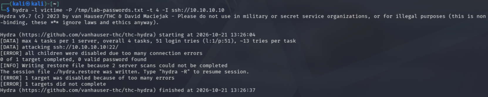
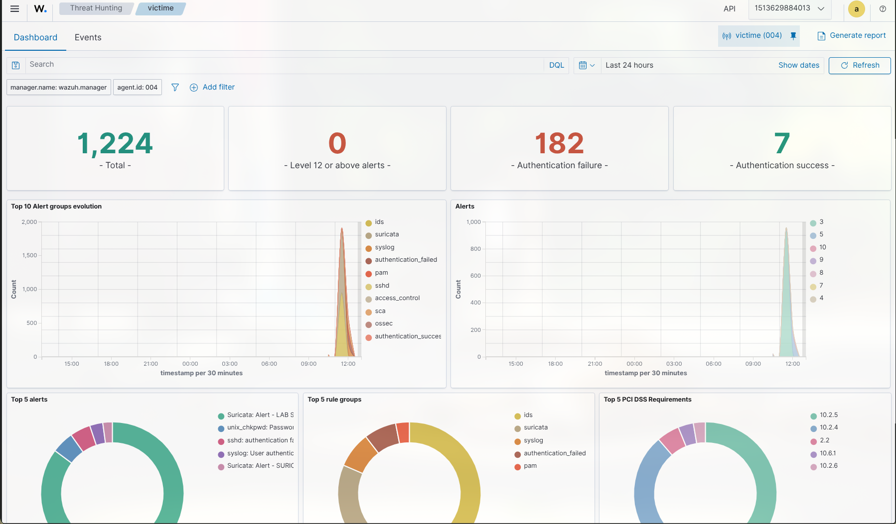
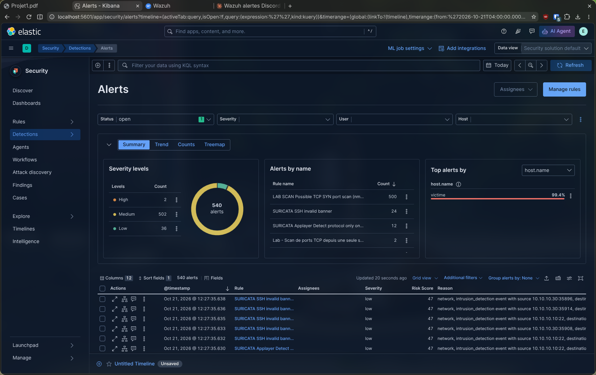
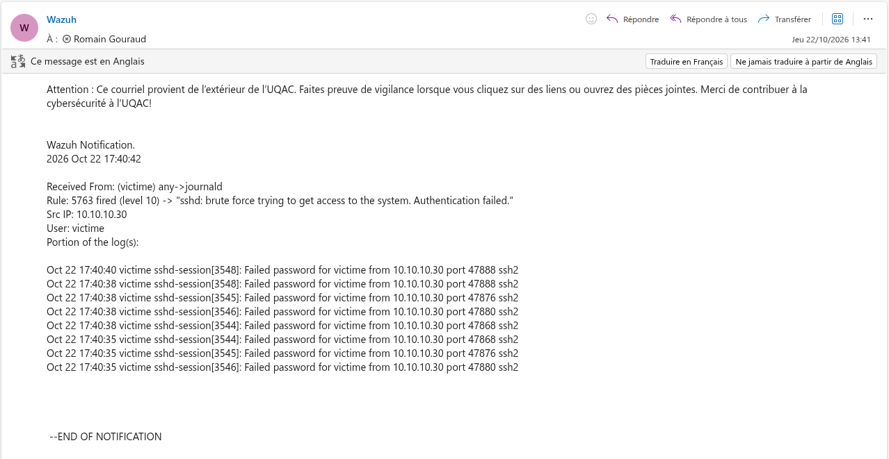

# Attaque 1 : Brute-force SSH

> Mode opératoire du scénario 1. Contexte et justification : [scénarios](00-scenarios.md#scénario-1--brute-force-ssh-). Prérequis : lab démarré (`lab/lab.sh up`).

- **But** : deviner un mot de passe SSH par essais répétés (MITRE T1110.001), et le détecter côté Wazuh (règles 5763 / 2502) et ELK (règle « Lab - Brute-force SSH »).
- **Cible** : `10.10.10.10`, compte `victime`.

## 1. Attaque (sur Kali)

```bash
# Liste dédiée : ~20 essais suffisent (seuil de détection = 10 échecs/min).
zcat /usr/share/wordlists/rockyou.txt.gz | head -20 > /tmp/lab-passwords.txt
# Variante "succès" : ajouter le vrai mot de passe en dernier — echo 'MDP' >> /tmp/lab-passwords.txt

hydra -l victime -P /tmp/lab-passwords.txt -t 4 -I ssh://10.10.10.10
```

## 2. Vérifications

**Victime**, échecs journalisés puis collectés par syslog-ng :

```bash
sudo grep "Failed password" /var/log/auth.log | tail
sudo grep "Failed password" /var/log/security-collected.log | tail   # chaîne Wazuh
```

**Hôte**, ingestion dans Elasticsearch :

```bash
cd ~/cours/secu-info/projet-ids/elk
AUTH="elastic:$(grep ^ELASTIC_PASSWORD= .env | cut -d= -f2)"
curl -s --cacert ca.crt -u "$AUTH" \
  "https://localhost:9200/logs-system.auth-default/_count?q=event.outcome:failure%20AND%20source.ip:10.10.10.30%20AND%20@timestamp:%3Enow-10m"
```

**Wazuh** (`wazuh.grdr.fr` → Threat Hunting, `agent.name: victime`) : règles 5763 et 2502 (niveau 10), `data.srcip: 10.10.10.30`.

**Kibana** (`localhost:5601`) :
- *Discover* : `event.dataset:"system.auth" and event.outcome:"failure" and source.ip:"10.10.10.30"`
- *Security → Alerts* : alerte « Lab - Brute-force SSH » (règle de seuil, 10 échecs/min par IP+compte ; laisser 1–2 min).

## 3. Résultat obtenu

Attaque jouée le 21/10/2026 (« échecs seuls »), détection confirmée des deux côtés.



hydra affiche `all children were disabled` : c'est la pénalité OpenSSH 9.8 qui coupe les connexions (voir [ci-dessous](#openssh-98-et-la-pénalité-anti-brute-force)), pas un échec de la collecte.



**Wazuh** : l'agent `victime` remonte 182 échecs d'authentification (groupes `authentication_failed`, `sshd`, `pam`).



**Elastic** : alertes concentrées à 99 % sur `victime` ; l'alerte de seuil « Lab - Brute-force SSH » se déclenche sur les échecs ingérés.



## 4. OpenSSH 9.8 et la pénalité anti-brute-force

Debian 13 active par défaut les `PerSourcePenalties` d'OpenSSH 9.8 : après quelques échecs, sshd pénalise l'IP source et rejette ses connexions suivantes (`drop connection … penalty` dans `auth.log`), d'où le `all children were disabled` de hydra. Ces connexions rejetées ne produisent pas de `Failed password` et ne comptent pas pour la détection. C'est un point à mentionner dans le rapport : l'hôte freine nativement le brute-force.

| Option | Commande | Pour / contre |
| --- | --- | --- |
| **A, garder la pénalité** (défaut) | `hydra … -t 1 -W 1 …` (un essai à la fois) | réaliste ; détection plus lente à atteindre le seuil |
| **B, désactiver** | `PerSourcePenalties no` dans `sshd_config` + `systemctl restart ssh` | démo nette ; modifie la posture de la victime |

La détection fonctionne même en option A (test : 53 échecs ingérés, alerte ELK déclenchée). Pour rendre l'option B permanente, l'intégrer à l'image ([modifier l'image](../0-lancer-le-lab.md#modifier-limage-de-la-victime)).

> `could not resolve address: 10.10.10.10` = faute de frappe dans l'IP (souvent `O` au lieu de `0`).

## 5. Réponse de l'administrateur

Cette section couvre la chaîne complète : alerte → notification → explication → réponse.

### 5.1 Alertes et notifications déclenchées

| Plateforme | Règle | Niveau | Notifiée (Discord/courriel ≥ 10) |
| --- | --- | --- | --- |
| Wazuh | **5763**, brute force SSH | 10 | ✅ oui |
| Wazuh | **2502**, échecs répétés (via syslog-ng) | 10 | ✅ oui |
| ELK | « Lab - Brute-force SSH » (≥ 10 échecs / IP + compte) | haute | ❌ visible dans *Security → Alerts* uniquement (connecteurs payants, voir [détection ELK](../1-elk/03-detection.md#notifications--limite-de-la-licence-gratuite)) |

Les deux règles Wazuh sont de niveau 10 : elles franchissent le seuil de l'intégration Discord et du courriel ([configuration](../2-wazuh/01-deploiement.md#notifications)) sans réglage supplémentaire. L'administrateur est donc prévenu en dehors du dashboard, sans avoir à le surveiller.

### 5.2 Ce que reçoit l'administrateur

Message type (exemple indicatif du contenu, la mise en forme exacte dépend de l'intégration) :

```
[Wazuh] Alerte niveau 10 — règle 5763
Description : sshd: brute force trying to get access to the system. Authentication failed.
Agent       : victime (004)
Source      : 10.10.10.30
Compte visé : victime
Occurrences : 8 échecs en moins de 2 min
```

### 5.3 Explication pour l'administrateur

| Question | Réponse |
| --- | --- |
| **Que s'est-il passé ?** | Une même IP (`10.10.10.30`) a enchaîné des échecs d'authentification SSH sur le compte `victime`, à un rythme impossible pour un humain. |
| **Pourquoi est-ce une alerte ?** | Un utilisateur légitime se trompe 2 ou 3 fois ; dix échecs par minute sur un même compte révèlent un outil automatisé (hydra). Le regroupement par IP et compte distingue une attaque ciblée d'un balayage de comptes. |
| **Quelle gravité ?** | Haute si une connexion a réussi : l'attaquant a alors un shell. Sans succès, c'est une tentative, pas encore une compromission. |
| **Alerte confirmée ou faux positif ?** | Source interne connue (poste d'un collègue, script de sauvegarde mal configuré) → faux positif probable. IP inconnue, échecs sur plusieurs comptes, ou rythme régulier → intrusion à traiter. |
| **Et après ?** | Le brute-force est un accès initial : il prépare les scénarios 4 et 5 (persistance, malware) s'il aboutit. |

### 5.4 Actions de réponse

**1. Qualifier : une connexion a-t-elle réussi ?** (priorité absolue)

```bash
# Sur la victime
sudo grep "Accepted password" /var/log/auth.log | grep 10.10.10.30   # vide = aucun succès
sudo grep "Failed password" /var/log/auth.log | awk '{print $9, $11}' | sort | uniq -c | sort -rn | head
last -i | head                                                         # sessions récentes
```

Si un `Accepted password` apparaît pour `10.10.10.30` : traiter comme une compromission (changer le mot de passe, fermer les sessions, enchaîner avec les [attaques 4](04-modification-fichiers.md) et [5](05-malware-privileges.md) : recherche de persistance).

**2. Contenir : bloquer la source.**

```bash
sudo ufw deny from 10.10.10.30 to any port 22      # ou : sudo iptables -I INPUT -s 10.10.10.30 -p tcp --dport 22 -j DROP
```

Alternative automatique : la réponse active de Wazuh (module `firewall-drop`) bloque l'IP à la détection de la règle 5763 ; à n'activer qu'après avoir listé les IP à ne jamais bloquer (administrateurs, supervision).

**3. Durcir : imposer l'authentification par clé.**

```bash
# /etc/ssh/sshd_config.d/hardening.conf
PasswordAuthentication no
PermitRootLogin no
MaxAuthTries 3
```

```bash
sudo sshd -t && sudo systemctl reload ssh   # tester la config avant de recharger, garder une session ouverte
```

> Prérequis : avoir déposé sa clé publique (`ssh-copy-id`) avant de désactiver les mots de passe, sous peine de s'enfermer dehors.

**4. Tracer : documenter l'incident** (IP, horodatage, compte visé, règle, décision) et vérifier que l'alerte est bien passée en *Closed* dans Kibana / traitée dans Wazuh.

## 6. Remise à zéro

```bash
cd ~/cours/secu-info/projet-ids/lab && ./lab.sh down && ./lab.sh reset && ./lab.sh up
```
