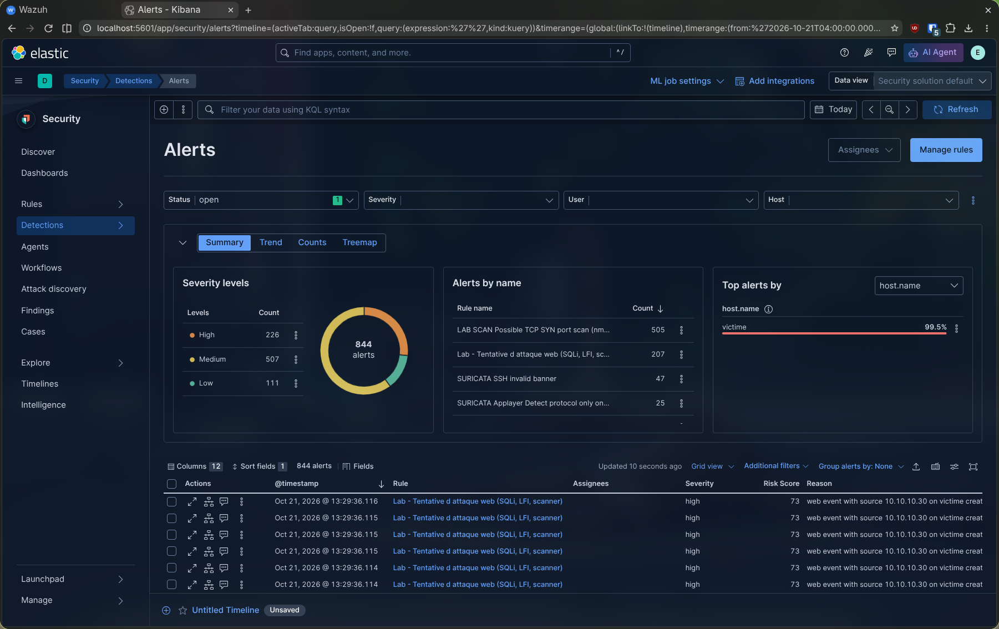
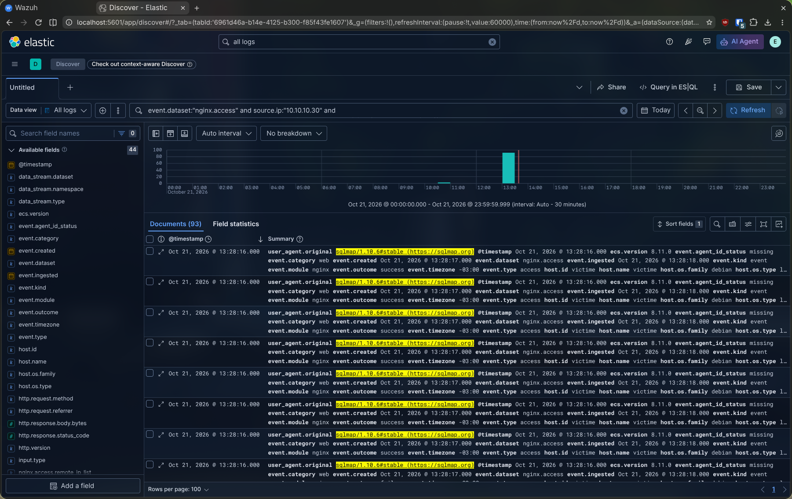
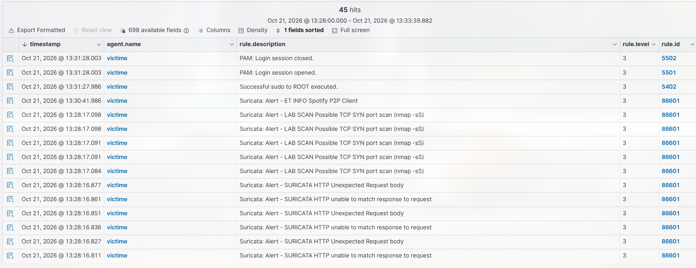

# Attaque 2 — Attaque web (SQLi, LFI)

> Mode opératoire du scénario 2. Contexte et justification : [scénarios](00-scenarios.md#scénario-2--attaque-web-injection-sql-lfi-). Prérequis : lab démarré (`lab/lab.sh up`).

- **But** : exploiter DVWA par injection SQL et inclusion de fichier local (MITRE T1190), et le détecter côté **ELK** (règle « Lab - Attaque web ») et **Wazuh** (Suricata).
- **Cible** : `http://10.10.10.10`, DVWA en sécurité *Low*.

## 1. Préparation

DVWA est déjà installé sur l'image de la victime. Pour une installation neuve :

```bash
sudo bash -c "$(curl -fsSL https://raw.githubusercontent.com/IamCarron/DVWA-Script/main/Install-DVWA.sh)"
```

DVWA exige une session : sans elle, toute URL renvoie vers `login.php`. Sur Kali, ouvrir une session (`admin`/`password`) et préparer un cookie `security=low` :

```bash
cd /tmp
TOKEN=$(curl -s -c dvwa.cookie http://10.10.10.10/login.php \
  | grep -oE "user_token' value='[a-f0-9]{32}" | grep -oE '[a-f0-9]{32}')
curl -s -b dvwa.cookie -c dvwa.cookie \
  -d "username=admin&password=password&user_token=$TOKEN&Login=Login" \
  http://10.10.10.10/login.php -o /dev/null
SID=$(grep PHPSESSID dvwa.cookie | awk '{print $NF}')
COOKIE="security=low; PHPSESSID=$SID"
```

## 2. Attaque (sur Kali)

```bash
# Injection SQL manuelle
curl -s -b "$COOKIE" \
  "http://10.10.10.10/vulnerabilities/sqli/?id=1'%20OR%20'1'='1&Submit=Submit" | grep -i surname
# Inclusion de fichier local (5 niveaux ../ : DVWA est profond)
curl -s -b "$COOKIE" \
  "http://10.10.10.10/vulnerabilities/fi/?page=../../../../../etc/passwd" | grep "^root:"
# Scanner web + injection automatisée (bruyants : user-agent reconnaissable)
nikto -h http://10.10.10.10
sqlmap -u "http://10.10.10.10/vulnerabilities/sqli/?id=1&Submit=Submit" --cookie="$COOKIE" --batch --dbs
```

## 3. Vérifications

**Victime** — requêtes journalisées par nginx :

```bash
sudo grep -E "UNION|OR '1'='1|etc/passwd|sqlmap|Nikto" /var/log/nginx/access.log | tail
```

**Hôte** — ingestion dans Elasticsearch :

```bash
cd ~/cours/secu-info/projet-ids/elk
AUTH="elastic:$(grep ^ELASTIC_PASSWORD= .env | cut -d= -f2)"
curl -s --cacert ca.crt -u "$AUTH" \
  "https://localhost:9200/logs-nginx.access-default/_count?q=source.ip:10.10.10.30%20AND%20@timestamp:%3Enow-10m"
```

**Wazuh** (`wazuh.grdr.fr` → Threat Hunting, `agent.name: victime`) : alertes Suricata ET Open sur SQLi/LFI/scanners (groupe `ids`). Les lignes nginx passent par le collecteur et ne sont pas décodées par les règles `web` natives — pour cela, ajouter sur la victime une source `localfile` directe sur `/var/log/nginx/access.log`.

**Kibana** (`localhost:5601`) :
- *Discover* : `event.dataset:"nginx.access" and source.ip:"10.10.10.30" and (url.original:(*UNION* or *%27* or *etc/passwd*) or user_agent.original:(*sqlmap* or *Nikto*))`
- *Security → Alerts* : alerte **« Lab - Tentative d'attaque web »** (règle de requête, laisser 1–2 min).

## 4. Résultat obtenu

Attaque jouée le 21/10/2026 (SQLi, LFI, `nikto`, `sqlmap`), détection confirmée des deux côtés.

Les requêtes apparaissent dans nginx avec le user-agent de l'outil, et le volume ingéré confirme l'intensité (**8 207 documents** `nginx.access` en 10 min) :

```
10.10.10.30 - - [21/Oct/2026:14:28:16] "GET /vulnerabilities/sqli/?id=1%27%20ORDER%20BY%206--%20- ..." 500 "sqlmap/1.10.6#stable"
10.10.10.30 - - [21/Oct/2026:14:28:16] "GET /vulnerabilities/sqli/?id=1%27%20UNION%20ALL%20SELECT%20NULL%2CCONCAT(...)--%20- ..." 200 "sqlmap/1.10.6#stable"
```



**Elastic** : la règle « Lab - Tentative d'attaque web » se déclenche (*high*, risk 73, source `10.10.10.30`) — **207 alertes**, à **99,5 %** sur `victime`.



Dans Discover, les requêtes `nginx.access` portent le user-agent `sqlmap/1.10.6`, parsé en ECS.



**Wazuh** : la détection remonte par **Suricata** (règle `86601` : `SURICATA HTTP Unexpected Request body`…), conforme à la remarque de l'étape 3.

## 5. Points d'attention

- **Session + sécurité *Low* obligatoires.** Sans le cookie de l'étape 1, les requêtes sont redirigées (302) et aucune attaque n'a lieu.
- **Capteurs complémentaires.** Suricata analyse les paquets ; la règle ELK relit l'URL décodée par nginx.
- **HTTP en clair.** Suricata voit le contenu ; en HTTPS, seules les lignes nginx resteraient exploitables (voir [bilan](../4-bilan-elk-vs-wazuh.md#limites-du-projet)).

## 6. Réponse de l'administrateur

Cette section couvre la chaîne complète : **alerte → notification → explication → réponse**.

### 6.1 Alertes et notifications déclenchées

| Plateforme | Règle | Niveau par défaut | Notifiée (seuil ≥ 10) |
| --- | --- | --- | --- |
| Wazuh | **86601** — alerte Suricata (signatures ET Open SQLi / LFI / scanners) | 3 | ❌ **non**, sans réglage (voir ci-dessous) |
| ELK | « Lab - Tentative d'attaque web » (*high*, risk 73) | haute | ❌ *Security → Alerts* uniquement |

**Point d'attention : une alerte web ne dépasse pas le seuil par défaut.** La règle Suricata 86601 est de faible niveau (3) : avec un seuil Slack/courriel à 10, l'administrateur ne serait **pas** prévenu d'une attaque web. Il faut une règle locale qui rehausse le niveau des alertes de la catégorie web (`/var/ossec/etc/rules/local_rules.xml` sur le manager) :

```xml
<group name="local,web,attack,">
  <rule id="100020" level="10">
    <if_sid>86601</if_sid>
    <field name="alert.category">Web Application Attack</field>
    <description>Lab - Attaque web détectée par Suricata (SQLi/LFI/scanner)</description>
    <mitre><id>T1190</id></mitre>
  </rule>
</group>
```

```bash
# Valider avant de recharger (coller un événement eve.json réel dans wazuh-logtest)
/var/ossec/bin/wazuh-logtest
/var/ossec/bin/wazuh-control restart
```

> Règle à valider avec l'événement réellement observé : le champ exact (`alert.category`, `alert.signature`) dépend de la signature ET Open qui s'est déclenchée.

Sur ELK, il n'existe pas de notification gratuite : l'alerte reste dans Kibana (ou nécessite un script externe qui relit `.alerts-security.alerts-default`).

### 6.2 Ce que reçoit l'administrateur

Message type (exemple indicatif) :

```
[Wazuh] Alerte niveau 10 — règle 100020
Description : Lab - Attaque web détectée par Suricata (SQLi/LFI/scanner)
Agent       : victime (004)
Source      : 10.10.10.30 → 10.10.10.10:80
Signature   : ET WEB_SERVER … (SQL Injection / Local File Inclusion)
```

### 6.3 Explication pour l'administrateur

| Question | Réponse |
| --- | --- |
| **Que s'est-il passé ?** | Une même IP a envoyé à DVWA des requêtes contenant des motifs d'injection SQL (`UNION`, `'`, `OR 1=1`), de traversée de répertoire (`../`, `/etc/passwd`) et des user-agents d'outils (`sqlmap`, `Nikto`). |
| **Pourquoi est-ce une alerte ?** | Deux capteurs indépendants concordent : Suricata reconnaît la signature dans le paquet, la règle ELK relit l'URL décodée par nginx. Une requête isolée peut être une erreur ; ici, le volume (**8 207** requêtes en 10 min, 207 alertes) et le user-agent excluent l'accident. |
| **Quelle gravité ?** | Élevée si l'attaque réussit : vol de la base (comptes, mots de passe), lecture de fichiers système, puis exécution de code. Les codes retour (`200` sur un `UNION`, `500` sur `ORDER BY`) montrent que l'application **répond** à l'injection : elle est vulnérable. |
| **Alerte confirmée ou faux positif ?** | Un scanner de vulnérabilités autorisé (audit interne) produit les mêmes alertes : comparer l'IP à la liste des scanners connus. Sinon, intrusion confirmée. |
| **Et après ?** | Une SQLi réussie peut mener à un webshell (scénario 4) : chercher des fichiers `.php` récents dans `/var/www`. |

### 6.4 Actions de réponse

**1. Qualifier : l'attaque a-t-elle abouti ?**

```bash
# Requêtes ayant renvoyé un contenu (200) vers les pages vulnérables, depuis la source
sudo grep "10.10.10.30" /var/log/nginx/access.log | grep -E "UNION|etc/passwd" | awk '$9==200' | wc -l
# Volumétrie des réponses : un pic d'octets servis évoque une exfiltration
sudo awk '$1=="10.10.10.30" {s+=$10} END {print s/1024/1024 " Mo"}' /var/log/nginx/access.log
# Fichiers PHP récents ajoutés (webshell ?)
sudo find /var/www -name "*.php" -mtime -1 -ls
# Journal MariaDB : requêtes inhabituelles
sudo journalctl -u mariadb --since "-1h" | tail -50
```

**2. Contenir : bloquer la source.**

```bash
sudo ufw deny from 10.10.10.30 to any port 80
```

**3. Corriger la cause (et pas seulement le symptôme).**

| Faille | Correctif |
| --- | --- |
| Injection SQL | Requêtes préparées (PDO / `mysqli_prepare`) au lieu de la concaténation de `$_GET['id']` |
| LFI | Liste blanche des pages incluables ; interdire `../` ; désactiver `allow_url_include` |
| Absence de filtrage | WAF (ModSecurity + règles OWASP CRS) devant nginx |
| Compte BD trop puissant | Utilisateur MariaDB limité (pas `FILE`, lecture seule si possible) |

**4. Si des données ont pu fuiter** : changer les mots de passe stockés en base, considérer la machine comme compromise (voir [attaque 4](04-modification-fichiers.md#5-réponse-de-ladministrateur)) et conserver les logs comme preuve.

**5. Tracer** : consigner IP, URL, horodatage, signature, décision.


## 7. Remise à zéro

```bash
cd ~/cours/secu-info/projet-ids/lab && ./lab.sh down && ./lab.sh reset && ./lab.sh up
```
