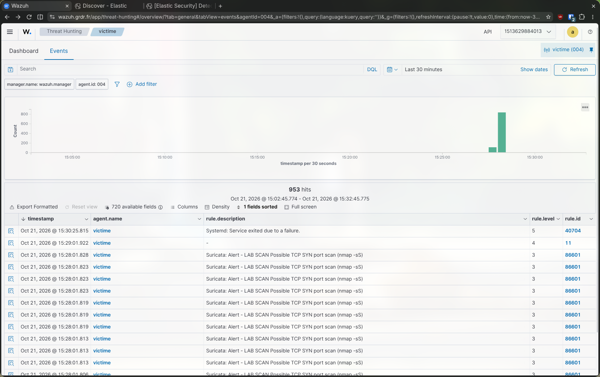
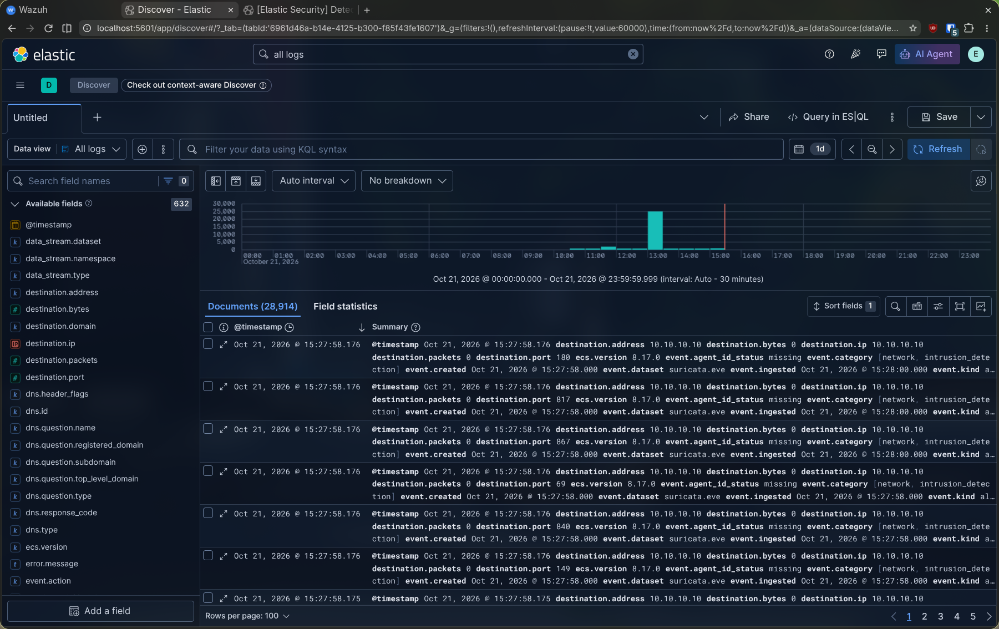
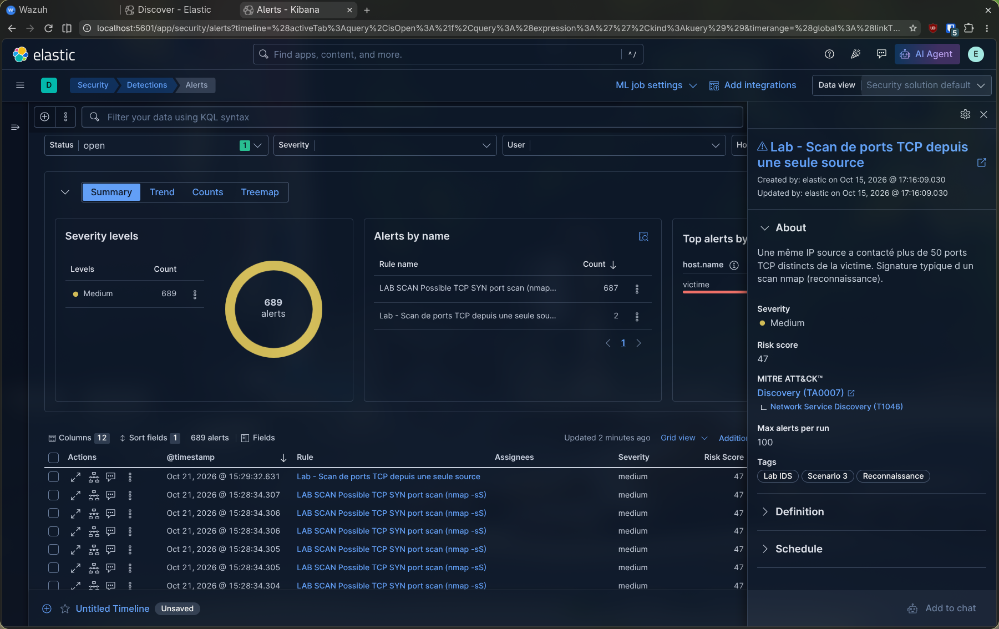

# Attaque 3 — Scan de ports

> Mode opératoire du scénario 3. Contexte et justification : [scénarios](../2-wazuh/02-scenarios.md#scénario-3--scan-de-ports-). Prérequis : lab démarré (`lab/lab.sh up`).

- **But** : cartographier les ports TCP ouverts de la victime (MITRE T1046, reconnaissance), et le détecter côté **ELK** (règles « Lab - Scan de ports » et « Lab - Alerte Suricata ») et **Wazuh** (Suricata, `sid:1000001`).
- **Cible** : `10.10.10.10`.

## 1. Attaque (sur Kali)

```bash
# Scan SYN des 1000 premiers ports. -sS = demi-ouvert (ne termine pas la connexion).
nmap -sS -p 1-1000 10.10.10.10
# Variante plus agressive (tous les ports) : nmap -sS -p- 10.10.10.10
```

Le scan SYN envoie un `SYN` par port et attend le `SYN/ACK` sans finaliser la poignée de main : rapide et discret côté application, mais une même source touche des dizaines de ports en quelques secondes — c'est ce que les deux capteurs repèrent.

## 2. Vérifications

**Victime** — alerte de la signature custom dans `eve.json` :

```bash
sudo grep "LAB SCAN" /var/log/suricata/eve.json | tail
```

**Hôte** — flux Suricata ingérés dans Elasticsearch :

```bash
cd ~/cours/secu-info/projet-ids/elk
AUTH="elastic:$(grep ^ELASTIC_PASSWORD= .env | cut -d= -f2)"
curl -s --cacert ca.crt -u "$AUTH" \
  "https://localhost:9200/logs-suricata.eve-default/_count?q=event.dataset:suricata.eve%20AND%20network.transport:tcp%20AND%20destination.ip:10.10.10.10%20AND%20@timestamp:%3Enow-10m"
```

**Wazuh** (`wazuh.grdr.fr` → Threat Hunting, `agent.name: victime`) : alerte Suricata **« LAB SCAN Possible TCP SYN port scan »** (groupe `ids`).

**Kibana** (`localhost:5601`) :
- *Discover* : `event.dataset:"suricata.eve" and network.transport:"tcp" and destination.ip:"10.10.10.10"` — un flux par port touché.
- *Security → Alerts* : deux règles se déclenchent (laisser jusqu'à ~6 min, voir ci-dessous) :
  - **« Lab - Scan de ports »** : seuil + cardinalité (une IP source → plus de 50 ports distincts).
  - **« Lab - Alerte Suricata »** : promotion de l'alerte de la signature custom.

## 3. Résultat obtenu

Attaque jouée le 21/10/2026 (`nmap -sS -p 1-1000`), détection confirmée des deux côtés.

```bash
┌──(kali㉿kali)-[/tmp]
└─$ nmap -sS -p 1-1000 10.10.10.10
Starting Nmap 7.99 ( https://nmap.org ) at 2026-10-21 16:27 -0300
Nmap scan report for victime (10.10.10.10)
Host is up (0.00024s latency).
Not shown: 998 closed tcp ports (reset)
PORT   STATE SERVICE
22/tcp open  ssh
80/tcp open  http
MAC Address: 52:54:00:3F:44:0A (QEMU virtual NIC)

Nmap done: 1 IP address (1 host up) scanned in 0.17 seconds
```

`nmap` ne trouve que deux ports ouverts (22/SSH, 80/HTTP), mais pour le confirmer il a frappé les 1000 ports : c'est ce bruit qui est détecté.



**Wazuh** : la signature custom `sid:1000001` remonte via Suricata (règle `86601`), avec la source `10.10.10.30`.



**Elastic (Discover)** : chaque port balayé produit un flux `suricata.eve` vers `10.10.10.10` (`destination.port` différent à chaque ligne). C'est ce volume brut que la règle de seuil **« Lab - Scan de ports »** agrège.



**Elastic (Security → Alerts)** : la règle de seuil se déclenche à partir de ces flux agrégés (une même `source.ip` a dépassé 50 `destination.port` distincts). À ne pas confondre avec *Observability → Alerts*, qui ne montre pas les règles de détection.

## 4. Points d'attention

- **Deux chemins de détection en ELK.** La règle de **seuil** s'appuie sur les **flux** Suricata (aucune signature nécessaire) : aucun flux pris seul n'est suspect, c'est leur agrégation (> 50 ports par source) qui l'est. La règle de **promotion** remonte en plus l'alerte de la signature custom `sid:1000001`. Les deux sont utiles : la première résiste même si une signature manque, la seconde donne une alerte immédiate.
- **Délai d'alerte (~6 min).** Suricata n'écrit un flux qu'à son **expiration** (≈ 1 min pour un SYN resté sans réponse). La fenêtre de 6 min de la règle de seuil absorbe ce délai : l'alerte n'est donc pas instantanée. La signature custom, elle, déclenche dès le dépassement du seuil (> 50 SYN en 5 s).
- **Volume d'alertes de la signature.** `detection_filter` déclenche une alerte **par SYN au-delà du 50e** : un scan de 1000 ports produit ~950 alertes. Pour n'en garder qu'une par source et par fenêtre, remplacer `detection_filter:…` par `threshold:type both, track by_src, count 50, seconds 5` dans `local.rules`.
- **ET Open ne détecte pas les scans** par défaut : c'est la raison d'être de la signature custom et de la règle de flux. Détail dans [détection ELK](../1-elk/03-detection.md#scan-de-ports).

## 5. Réponse de l'administrateur

Bloquer `10.10.10.30` · n'exposer que les ports nécessaires (pare-feu) · corréler avec les attaques suivantes (le scan précède souvent un brute-force ou une attaque web depuis la même source).

## 6. Remise à zéro

```bash
cd ~/cours/secu-info/projet-ids/lab && ./lab.sh down && ./lab.sh reset && ./lab.sh up
```
