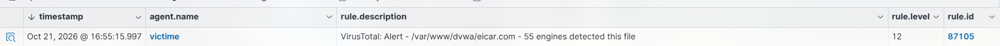
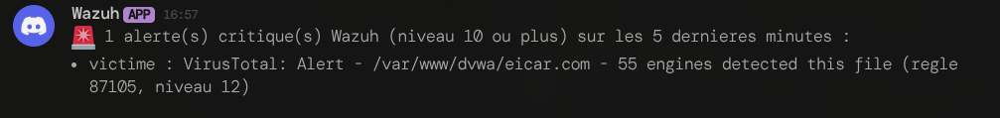
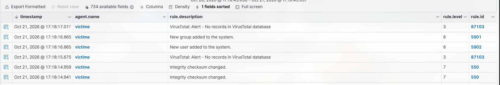

# Attaque 5 : Malware et élévation de privilèges

> Mode opératoire du scénario 5. Contexte et justification : [scénarios](00-scenarios.md#scénario-5--malware-et-élévation-de-privilèges-). Prérequis : lab démarré (`lab/lab.sh up`).

- **But** : simuler un attaquant déjà présent qui dépose un fichier malveillant (MITRE T1105) et se crée un compte privilégié (T1136.001), et le détecter côté Wazuh : FIM (fichier ajouté), analyse antivirus par VirusTotal, et suivi des comptes système.
- **Particularité** : comme le scénario 4, aucune trace réseau d'attaque, ELK ne détecte rien. Le scénario illustre deux capacités propres à un HIDS : le renseignement sur les menaces (VirusTotal) et le suivi des comptes système.

## 1. Attaque (sur la victime)

Les commandes se lancent sur la victime (root), comme pour l'attaque 4.

```bash
# 1. Fichier de test EICAR : inoffensif, mais reconnu « malveillant » par tous les antivirus.
#    Écrit en clair (aucun accès Internet requis) dans un répertoire surveillé par la FIM.
echo 'X5O!P%@AP[4\PZX54(P^)7CC)7}$EICAR-STANDARD-ANTIVIRUS-TEST-FILE!$H+H*' \
  > /var/www/dvwa/eicar.com

# 2. Création d'un compte et ajout au groupe sudo (= droits administrateur).
useradd -m backdoor && usermod -aG sudo backdoor
```

> Variante EICAR par téléchargement (la victime a un accès NAT) : `curl -s -o /var/www/dvwa/eicar.com https://secure.eicar.org/eicar.com`.

## 2. Vérifications

**Victime**, le compte et le fichier existent bien :

```bash
getent passwd backdoor && id backdoor          # backdoor doit être membre de sudo
ls -l /var/www/dvwa/eicar.com
```

**Wazuh** (`wazuh.grdr.fr` → Threat Hunting, `agent.name: victime`) :
- **Fichier ajouté** (groupe `syscheck`, règle 554) : `/var/www/dvwa/eicar.com`.
- **Compte créé** (groupe `adduser`) : « New user added to the system » (`backdoor`) et ajout au groupe `sudo`.
- **VirusTotal** (intégration active sur le manager) : à la suite de l'événement FIM, règle 87105 « *X engines detected this file* » sur `eicar.com`.

## 3. Résultat obtenu

Attaque jouée le 21/10/2026. Détection confirmée côté Wazuh (ELK muet, comme attendu). La chaîne VirusTotal fonctionne de bout en bout : dépôt du fichier → FIM → analyse antivirus → notification.



**Wazuh** : après l'événement FIM sur `eicar.com`, l'intégration VirusTotal renvoie une détection positive (règle `87105`), le fichier est reconnu malveillant par de nombreux moteurs.



**Notification** : l'alerte (niveau ≥ 10) est relayée automatiquement dans Discord, hors du dashboard, la boucle « détection → alerte » demandée par le sujet est bouclée.



**Compte privilégié** : la création de `backdoor` et son ajout au groupe `sudo` déclenchent une alerte du groupe `adduser`, c'est le second volet du scénario (persistance avec privilèges, T1136.001), détecté sans aucune trace réseau.

## 4. Points d'attention

- **VirusTotal enrichit la FIM.** La FIM seule détecte le dépôt du fichier (règle 554) ; l'intégration VirusTotal ([déploiement](../2-wazuh/01-deploiement.md#notifications)) y ajoute le verdict antivirus (règle 87105). Wazuh n'envoie que le hash MD5 du fichier signalé par syscheck à `api.virustotal.com`, jamais le fichier lui-même.
- **EICAR est sans danger.** Ce n'est pas un vrai virus : c'est une chaîne standard que tous les antivirus reconnaissent, prévue pour tester une chaîne de détection sans risque.
- **Deux signaux corrélés.** Fichier malveillant et compte privilégié créés quasi simultanément : c'est la signature d'une compromission active (exécution + persistance), pas d'une fausse alerte isolée.
- **Chaîne d'alerte.** Les notifications Discord/courriel configurées pour ce scénario relaient ces alertes de niveau ≥ 10 en dehors du dashboard.


## 5. Réponse de l'administrateur

Cette section couvre la chaîne complète : alerte → notification → explication → réponse.

### 5.1 Alertes et notifications déclenchées

| Plateforme | Règle | Niveau par défaut | Notifiée (seuil ≥ 10) |
| --- | --- | --- | --- |
| Wazuh | **87105**, VirusTotal « X engines detected this file » (si intégration active) | 12 | ✅ oui |
| Wazuh | **554**, fichier ajouté (`/var/www/dvwa/eicar.com`) | 5 | ❌ non, sans réglage |
| Wazuh | Création d'utilisateur / ajout au groupe `sudo` (groupe `adduser`) | 8 | ❌ non, sans réglage |
| ELK | aucune alerte (zéro trace réseau) | — | — |

Seule l'alerte VirusTotal franchit le seuil par défaut, et uniquement si la clé API est configurée. Sans elle, ni le dépôt du fichier ni la création du compte n'iraient à l'administrateur. Une règle locale rehausse les deux signaux, et une troisième les corrèle : c'est cette corrélation qui prouve la compromission active.

```xml
<group name="local,syscheck,adduser,">
  <rule id="100050" level="10">
    <if_sid>554</if_sid>
    <field name="file">^/var/www/</field>
    <description>Lab - Nouveau fichier dans le répertoire web (malware possible)</description>
    <mitre><id>T1105</id></mitre>
  </rule>
  <rule id="100051" level="10">
    <if_group>adduser</if_group>
    <description>Lab - Compte système créé ou modifié (privilèges possibles)</description>
    <mitre><id>T1136.001</id></mitre>
  </rule>
  <!-- Corrélation : fichier + compte en moins de 10 minutes = compromission active -->
  <rule id="100052" level="14" frequency="2" timeframe="600">
    <if_matched_sid>100050</if_matched_sid>
    <if_sid>100051</if_sid>
    <description>Lab - CRITIQUE : fichier suspect et compte privilégié créés en moins de 10 min</description>
  </rule>
</group>
```

```bash
# Sur le manager
/var/ossec/bin/wazuh-logtest          # valider avec les événements réels
/var/ossec/bin/wazuh-control restart
```

> La règle 100052 est une proposition à valider avec `wazuh-logtest` ; l'enchaînement exact des identifiants de règles dépend des événements relevés lors de l'attaque.

### 5.2 Ce que reçoit l'administrateur

Message type (exemple indicatif) :

```
[Wazuh] Alerte niveau 12 — règle 87105
Description : VirusTotal: Alert - /var/www/dvwa/eicar.com - 60+ engines detected this file
Agent       : victime (004)
Fichier     : /var/www/dvwa/eicar.com

[Wazuh] Alerte niveau 10 — règle 100051
Description : Lab - Compte système créé ou modifié (privilèges possibles)
Agent       : victime (004)
Compte      : backdoor
```

Deux messages rapprochés dans le temps, sur le même agent : c'est le signal clé.

### 5.3 Explication pour l'administrateur

| Question | Réponse |
| --- | --- |
| **Que s'est-il passé ?** | Un fichier reconnu malveillant (EICAR) est apparu dans le répertoire web, et un compte `backdoor` a été créé et ajouté au groupe `sudo`, donc administrateur. |
| **Pourquoi est-ce une alerte ?** | La FIM voit le dépôt, VirusTotal le qualifie (des dizaines de moteurs l'identifient comme un malware), le suivi des comptes signale la création d'un utilisateur privilégié. Trois sources, trois signaux concordants. |
| **Quelle gravité ?** | **Critique : exécution + persistance.** Un fichier malveillant et un compte privilégié créés presque en même temps, c'est une compromission active, pas une fausse alerte isolée. (Ici EICAR est inoffensif ; avec un vrai malware, l'attaquant exécuterait du code, et le compte `backdoor` lui garderait l'accès.) |
| **Alerte confirmée ou faux positif ?** | Un seul signal, avec une explication (administrateur créant un compte lors d'une arrivée, fichier de test volontaire) est un faux positif possible. Les deux ensemble, sans ticket ni changement planifié, ne s'expliquent pas. |
| **Et après ?** | Même chaîne que l'[attaque 4](04-modification-fichiers.md) : chercher le vecteur d'entrée (scénarios 1 et 2). |

### 5.4 Actions de réponse

**1. Qualifier : étendue de la compromission (avant nettoyage, pour conserver les preuves).**

```bash
# Que fait ce compte ? A-t-il servi ?
id backdoor ; getent group sudo
sudo lastlog -u backdoor ; sudo grep backdoor /var/log/auth.log
sudo ls -la /home/backdoor ; sudo cat /home/backdoor/.bash_history 2>/dev/null
# Autres comptes ou binaires ajoutés récemment
awk -F: '$3>=1000 {print $1,$3}' /etc/passwd
sudo find / -xdev -type f -newermt "-1 day" 2>/dev/null | head -50
sudo find / -xdev -perm -4000 -type f -newermt "-1 day" 2>/dev/null     # nouveaux binaires setuid
# Persistance par planification
sudo ls -la /etc/cron.* /var/spool/cron 2>/dev/null
```

Conserver une copie du fichier et des logs.

**2. Contenir.**

```bash
sudo usermod -L backdoor && sudo pkill -u backdoor     # verrouiller et couper les sessions
sudo ufw deny from 10.10.10.30
```

**3. Éradiquer.**

```bash
sudo userdel -r backdoor
sudo rm -f /var/www/dvwa/eicar.com
```

**4. Trouver le vecteur d'entrée** par corrélation avec les scénarios 1 (brute-force réussi) et 2 (SQLi/LFI), depuis la même source.

**5. Reconstruire.** Un attaquant `sudo` a eu les droits root : toute modification est possible, y compris hors de la FIM. La machine est à reconstruire à partir d'une image saine, et tous les secrets renouvelés.

**6. Pour la détection : activer VirusTotal** (clé API sur le manager, voir [déploiement](../2-wazuh/01-deploiement.md#notifications)) si ce n'est pas fait ; sans lui, seul le signal de dépôt/compte subsiste.

## 6. Remise à zéro

```bash
# Sur la victime, retirer les artefacts
sudo userdel -r backdoor
sudo rm -f /var/www/dvwa/eicar.com
```

Ou repartir d'une image propre :

```bash
cd ~/cours/secu-info/projet-ids/lab && ./lab.sh down && ./lab.sh reset && ./lab.sh up
```